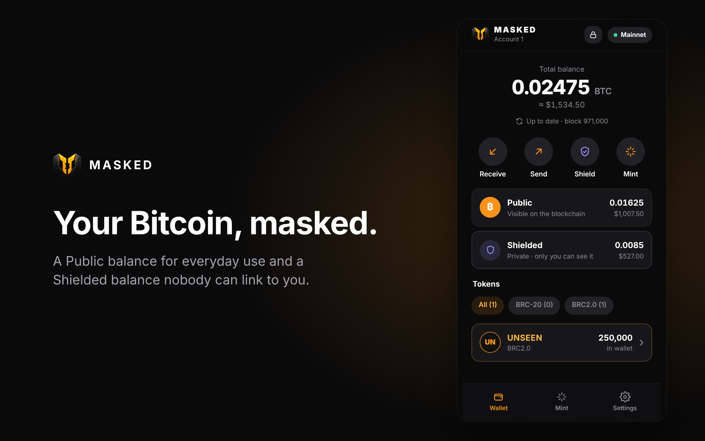
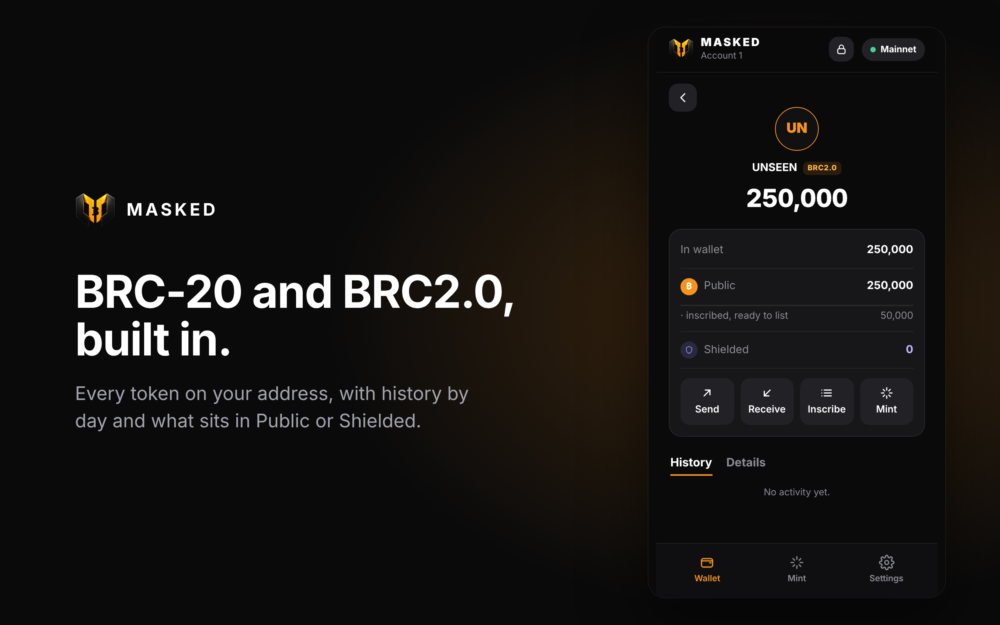
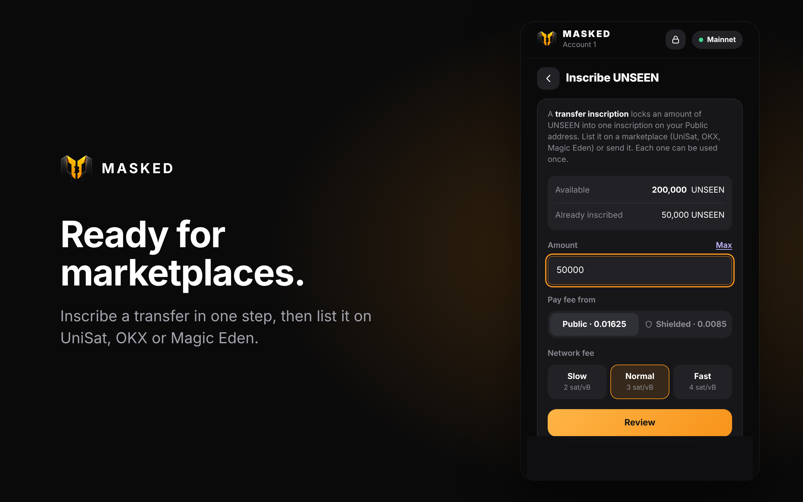

# MASKED

**A Bitcoin wallet with a private side.** MASKED is an open-source Chrome extension with two balances:

- **Public**: a normal taproot address (`bc1p…`) for exchanges, marketplaces and dApps.
- **Shielded**: a reusable [silent payment](https://github.com/bitcoin/bips/blob/master/bip-0352.mediawiki) address (`sp1…`, BIP 352). Every payment lands on a new one-time output, so nobody can look up what you hold or link your payments.

It mints, inscribes and sends BRC-20 and BRC2.0 tokens, and gives websites a UniSat-compatible provider, `window.masked`.

[**Add to Chrome**](https://chromewebstore.google.com/detail/masked-wallet/pojmpfcbdmacabhckemelcbkmckhaoig) · [maskedwallet.com](https://maskedwallet.com) · [@masked_wallet](https://x.com/masked_wallet)

<p>
  
  
  
</p>

> Experimental, unaudited software. Use small amounts. Read [SECURITY.md](SECURITY.md).

## Install

- **Chrome Web Store** (recommended, updates by itself): [MASKED Wallet](https://chromewebstore.google.com/detail/masked-wallet/pojmpfcbdmacabhckemelcbkmckhaoig). Works in Chrome, Brave and Edge.
- **From this repo:** open `chrome://extensions`, turn on Developer mode, press **Load unpacked** and pick the `extension/` folder.

## Build it yourself

Node 20+:

```sh
npm ci
npm test        # BIP 352 vectors, the fast scanner, private trading and wallet checks
npm run build   # rebuilds extension/ from src/
```

The build is reproducible: `extension/` built from this source is byte-for-byte the code published on the Chrome Web Store (the store package only drops the manifest `key`).

## Use it from your website: `window.masked`

MASKED injects `window.masked` into every page. It follows UniSat's `window.unisat`, so most dApps work with a one-line change.

```js
const wallet = window.masked ?? window.unisat;
if (!wallet) location.href = 'https://chromewebstore.google.com/detail/masked-wallet/pojmpfcbdmacabhckemelcbkmckhaoig';

// connect (opens an approval the first time)
const [address] = await wallet.requestAccounts();
const network = await wallet.getNetwork();          // 'livenet' or 'testnet' (Signet)
const { total } = await wallet.getBalance();        // sats on the Public address

// sign a message
const sig = await wallet.signMessage('hello', 'bip322-simple');

// pay, also to a silent payment (sp1…) address
const txid = await wallet.sendBitcoin('sp1qq…', 10_000);

// sign a PSBT (e.g. a marketplace listing with SIGHASH_SINGLE|ANYONECANPAY)
const signed = await wallet.signPsbt(psbtHex, { autoFinalized: true, toSignInputs: [{ index: 1, address, sighashTypes: [0x83] }] });
await wallet.pushPsbt(signed);

// BRC-20: inscribe a transfer, ready to list or send
const { inscriptionId } = await wallet.inscribeTransfer('ordi', '100');

// MASKED extras
const shielded = await wallet.getShieldedAddress();   // sp1… (receive privately)

wallet.on('accountsChanged', (accounts) => {});
wallet.on('networkChanged', (network) => {});
```

Wait for the provider if your script runs early:

```js
window.addEventListener('masked#initialized', () => start(window.masked), { once: true });
```

Every call that signs, pays or inscribes opens an approval in the MASKED popup that shows your site's name. Errors carry a `code`: `4001` rejected by the user, `4100` not connected, `4200` not supported, `4000` anything else.

Full reference: [docs/PROVIDER.md](docs/PROVIDER.md). A test page that calls every method: [examples/demo.html](examples/demo.html) (serve it over http(s)).

### Private trading

maskedwallet.com can trade from the Shielded balance: `getTradeAccount()`, `fundTradeAccount()`, `moveToTradeAccount()`, `returnToShielded()`, `cancelShieldedListing()` and `inscribeTransfer(ticker, amount, { account: 'shielded' })`. The site sees a private trade address and Shielded totals, never the Shielded address or its payments. These are limited to maskedwallet.com for now; see [docs/PROVIDER.md](docs/PROVIDER.md#private-trading-masked-only).

## How it works

| File | What it does |
|---|---|
| `src/sp-core.mjs` | BIP 352 silent payments: addresses, sending, scanning. Pure, checked against the official test vectors. |
| `src/sp-fast.mjs`, `src/scan-worker.mjs` | Fast scanning (libsecp256k1 in WebAssembly, one worker per CPU core). |
| `src/trade-core.mjs` | Private trading: trade addresses from the spend key, moves between Shielded and a trade address. |
| `src/app.mjs` | The wallet: vault, sync, sending, inscriptions, BRC-20 / BRC2.0, approvals. |
| `src/provider/` | `inpage.js` (`window.masked`), `content.js` (bridge), `background.js` (routing and approvals, never holds keys). |
| `extension-template/` | Manifest assets: page shell, icons. |

Keys stay in the browser: the recovery phrase is stored only as an AES-256-GCM vault (PBKDF2, 600,000 iterations). The background script and websites never see keys. Shielded scanning downloads public block data and never sends the scan key anywhere.

## Contributing and security

Pull requests are welcome: see [CONTRIBUTING.md](CONTRIBUTING.md). Please report security issues privately as described in [SECURITY.md](SECURITY.md).

## License

[MIT](LICENSE)
