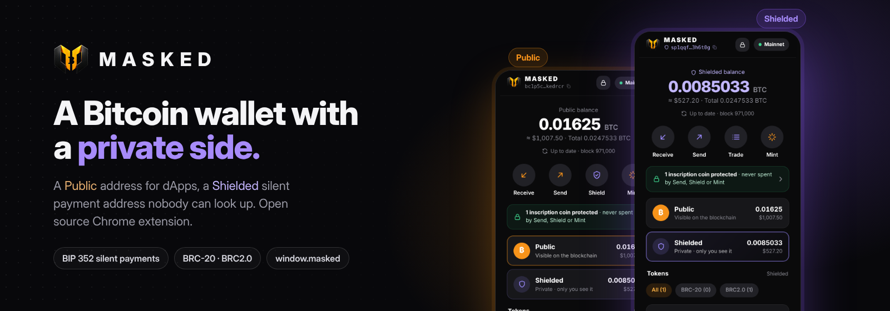
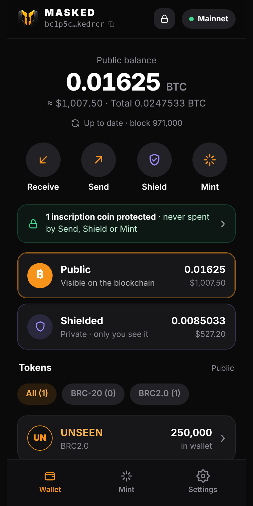
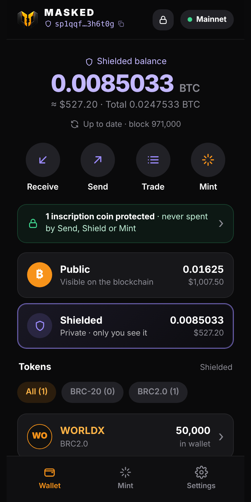
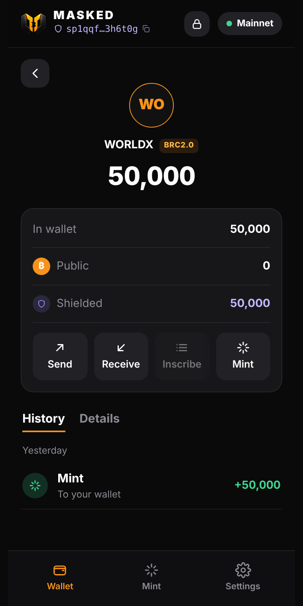
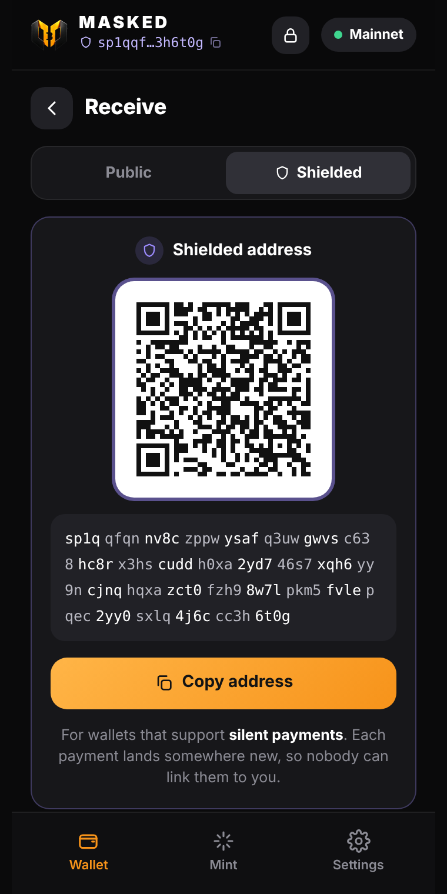
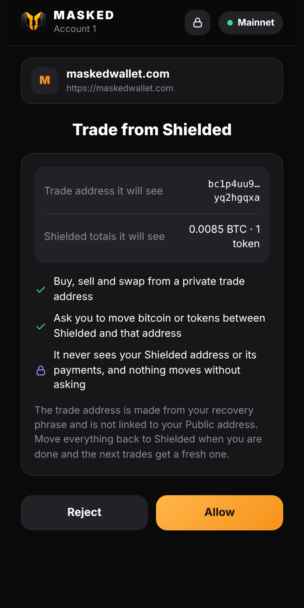
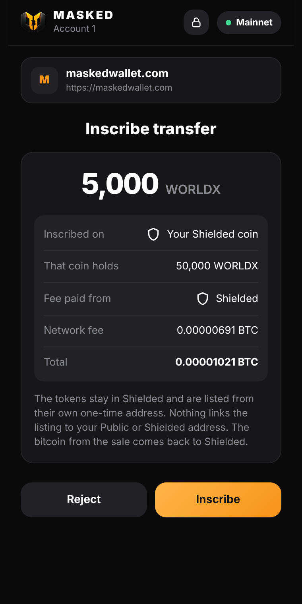
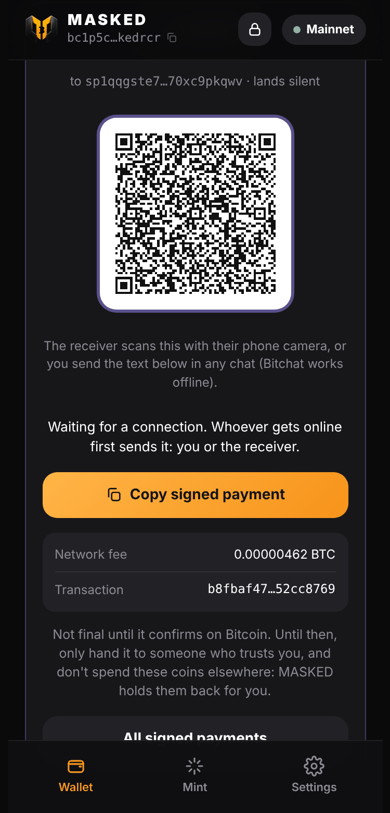
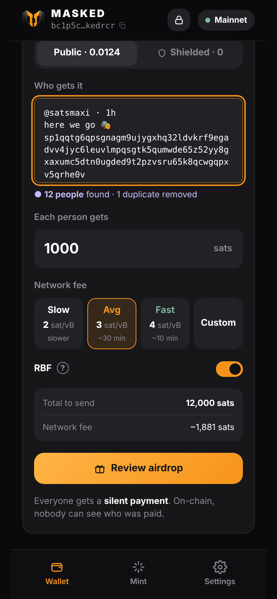
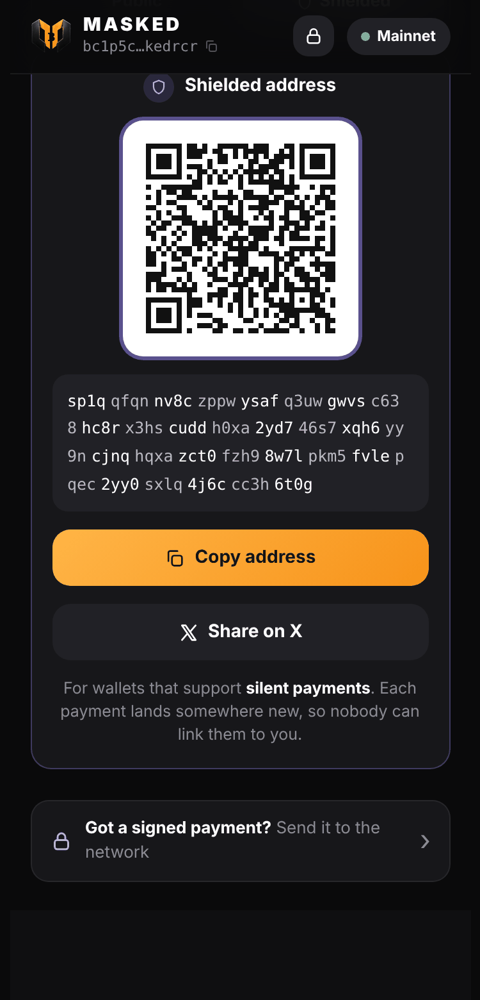

<p align="center"></p>

# MASKED

**A Bitcoin wallet with a private side.** MASKED is an open-source Chrome extension with two balances:

- **Public**: a normal taproot address (`bc1p…`) for exchanges, marketplaces and dApps.
- **Shielded**: a reusable [silent payment](https://github.com/bitcoin/bips/blob/master/bip-0352.mediawiki) address (`sp1…`, BIP 352). Every payment lands on a new one-time output, so nobody can look up what you hold or link your payments.

It also does:

- **Offline send:** sign a payment with no internet, then hand it over by QR code or as text, in any chat, Bitchat included. It is sent when either side gets online. See [docs/OFFLINE.md](docs/OFFLINE.md).
- **Silent airdrop:** paste a list of Shielded addresses (even a whole X reply thread) and pay everyone in one transaction, each with a silent payment. See [docs/AIRDROP.md](docs/AIRDROP.md).
- **Share on X:** post your Shielded address in one tap from Receive.
- **Several accounts:** add, rename, hide and switch accounts from one recovery phrase. Account N uses the Public address UniSat shows for its account N (`m/86'/coin'/0'/0/N`) and its own BIP 352 account for Shielded. See [docs/ACCOUNTS.md](docs/ACCOUNTS.md).
- **BRC-20 and BRC2.0:** mint, deploy, inscribe and send.
- **LEAF (CRC-20):** balances and sends on both sides, read from crc20.org with no node. Send to an `sp1…` and the receiver gets LEAF privately. See [docs/LEAF.md](docs/LEAF.md).
- **`window.masked`:** a UniSat-compatible provider for websites.

[**Add to Chrome**](https://chromewebstore.google.com/detail/masked-wallet/pojmpfcbdmacabhckemelcbkmckhaoig) · [maskedwallet.com](https://maskedwallet.com) · [@masked_wallet](https://x.com/masked_wallet)

> Experimental, unaudited software. Use small amounts. Read [SECURITY.md](SECURITY.md).

## Screenshots

| Public | Shielded | Shielded token |
|:-:|:-:|:-:|
|  |  |  |
| **Receive privately** | **Trade from Shielded** | **List straight from Shielded** |
|  |  |  |
| **Offline send** (2.14) | **Silent airdrop** (2.15) | **Share on X** (2.14) |
|  |  |  |

## Install

- **Chrome Web Store** (recommended, updates by itself): [MASKED Wallet](https://chromewebstore.google.com/detail/masked-wallet/pojmpfcbdmacabhckemelcbkmckhaoig). Works in Chrome, Brave and Edge.
- **From this repo:** open `chrome://extensions`, turn on Developer mode, press **Load unpacked** and pick the `extension/` folder.

## Build it yourself

Node 20+:

```sh
npm ci
npm run check   # lint, type check, and the tests (BIP 352 vectors, fast scanner, private trading, wallet services, offline send, airdrop, accounts, LEAF)
npm run build   # rebuilds extension/ from src/
```

The build is reproducible: the same source always gives the same `extension/`. The Chrome Web Store package is built from a tagged release, and only drops the manifest `key`.

| Version | What's new | Where |
|---|---|---|
| [`v2.12.9`](../../tree/v2.12.9) | the first Chrome Web Store version | GitHub |
| 2.13.0 | the same wallet, rewritten into classes and modules ([docs/ARCHITECTURE.md](docs/ARCHITECTURE.md)) | GitHub |
| [`v2.14.0`](../../tree/v2.14.0) | Offline send, Share on X | GitHub |
| [`v2.15.0`](../../tree/v2.15.0) | Silent airdrop | Chrome Web Store |
| [`v2.15.1`](../../tree/v2.15.1) | no scrollbar drawn in the popup (scroll with the trackpad or wheel, no wide grey bar on Windows) | GitHub |
| [`v2.16.0`](../../tree/v2.16.0) | several accounts from one phrase: add, rename, hide, switch (UniSat-compatible Public addresses) | GitHub |
| [`v2.18.0`](../../tree/v2.18.0) | LEAF (CRC-20): balances and sends, Public and Shielded | Chrome Web Store |
| [`v2.18.1`](../../tree/v2.18.1) | review fixes: locking reaches every open wallet window; confirmed Shielded change is spendable; Shielded LEAF lookups are opt-in; LEAF balances per account | GitHub |
| [`v2.18.2`](../../tree/v2.18.2) | small coins (1,000 sats or less) can be unlocked once ord confirms they're plain bitcoin; sends can use several coins; Reset coin list asks first and rescans since the wallet was created | GitHub |
| [`v2.18.3`](../../tree/v2.18.3) | security: look-alike address warnings, SIGHASH_NONE refused, big-move warnings, extension fingerprint to verify a release ([SECURITY.md](SECURITY.md)); LEAF reservations reconciled with the indexer | `main` |
| [`v2.15.2`](../../tree/v2.15.2) | redesigned unlock screen (show-password button, clearer wrong-password state); a side panel button in the header | GitHub |

## Use it from your website: `window.masked`

MASKED injects `window.masked` into every page. It follows UniSat's `window.unisat`, so most dApps work with a one-line change.

```js
const wallet = window.masked ?? window.unisat;
if (!wallet) location.href = 'https://chromewebstore.google.com/detail/masked-wallet/pojmpfcbdmacabhckemelcbkmckhaoig';

// connect (opens an approval the first time)
const [address] = await wallet.requestAccounts();
const network = await wallet.getNetwork();          // 'livenet' or 'testnet' (Signet)
const { total } = await wallet.getBalance();        // sats on the Public address

// sign a message
const sig = await wallet.signMessage('hello', 'bip322-simple');

// pay, also to a silent payment (sp1…) address
const txid = await wallet.sendBitcoin('sp1qq…', 10_000);

// sign a PSBT (e.g. a marketplace listing with SIGHASH_SINGLE|ANYONECANPAY)
const signed = await wallet.signPsbt(psbtHex, { autoFinalized: true, toSignInputs: [{ index: 1, address, sighashTypes: [0x83] }] });
await wallet.pushPsbt(signed);

// BRC-20: inscribe a transfer, ready to list or send
const { inscriptionId } = await wallet.inscribeTransfer('ordi', '100');

// MASKED extras
const shielded = await wallet.getShieldedAddress();   // sp1… (receive privately)

wallet.on('accountsChanged', (accounts) => {});
wallet.on('networkChanged', (network) => {});
```

Wait for the provider if your script runs early:

```js
window.addEventListener('masked#initialized', () => start(window.masked), { once: true });
```

Every call that signs, pays or inscribes opens an approval in the MASKED popup that shows your site's name. Errors carry a `code`: `4001` rejected by the user, `4100` not connected, `4200` not supported, `4000` anything else.

Full reference: [docs/PROVIDER.md](docs/PROVIDER.md). A test page that calls every method: [examples/demo.html](examples/demo.html) (serve it over http(s)).

### Private trading

maskedwallet.com can trade from the Shielded balance: `getTradeAccount()`, `fundTradeAccount()`, `moveToTradeAccount()`, `returnToShielded()`, `cancelShieldedListing()` and `inscribeTransfer(ticker, amount, { account: 'shielded' })`. The site sees a private trade address and Shielded totals, never the Shielded address or its payments. These are limited to maskedwallet.com for now; see [docs/PROVIDER.md](docs/PROVIDER.md#private-trading-masked-only).

## How it works

The wallet is a set of small classes wired together by one composition root (`src/app/MaskedApp.mjs`). Full map: [docs/ARCHITECTURE.md](docs/ARCHITECTURE.md).

| Folder | What it does |
|---|---|
| `src/crypto/` | BIP 352 silent payments (`sp-core.mjs`, pure, checked against the official vectors) and the WebAssembly scanner. |
| `src/bitcoin/`, `src/ordinals/` | Addresses, taproot, hand-built transactions and signatures; inscription envelopes and BRC-20 / BRC2.0 rules. |
| `src/wallet/` | Keys, coins and their protection, sends and inscriptions, offline-signed payments, silent airdrops, the encrypted vault. |
| `src/scan/` | Finding Shielded payments: the private check, worker threads, and syncing with the chain. |
| `src/tokens/`, `src/trade/` | Token balances and transactions; private trading from Shielded. |
| `src/dapp/`, `src/provider/` | `window.masked`: approvals and PSBT signing in the wallet; `inpage.js`, `content.js` and `background.js` (routing, never holds keys). |
| `src/ui/` | One class per screen, a renderer and one input controller. |
| `extension-template/` | Manifest assets: page shell, icons. |

Keys stay in the browser: the recovery phrase is stored only as an AES-256-GCM vault (PBKDF2, 600,000 iterations). The background script and websites never see keys. Shielded scanning downloads public block data and never sends the scan key anywhere.

## Contributing and security

Pull requests are welcome: see [CONTRIBUTING.md](CONTRIBUTING.md). Please report security issues privately as described in [SECURITY.md](SECURITY.md).

## License

[MIT](LICENSE)
