<p align="center">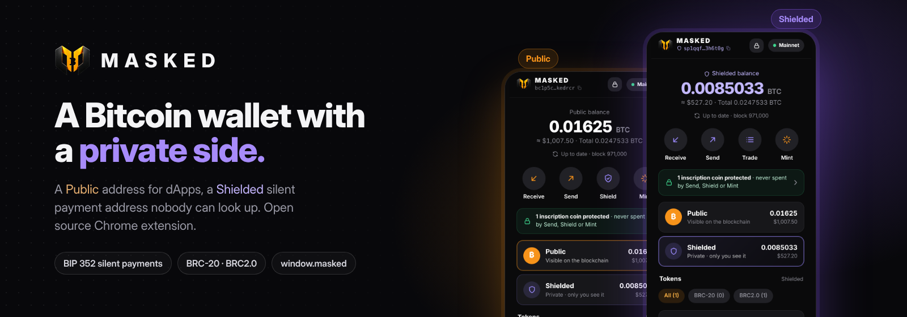</p>

# MASKED

**A Bitcoin wallet with a private side.** MASKED is an open-source Chrome extension with two balances, plus ecash:

- **Public**: a normal taproot address (`bc1p…`) for exchanges, marketplaces and dApps.
- **Shielded**: a reusable [silent payment](https://github.com/bitcoin/bips/blob/master/bip-0352.mediawiki) address (`sp1…`, BIP 352). Every payment lands on a new one-time output, so nobody can look up what you hold or link your payments.
- **Ordinals** (new in 2.21): see your inscriptions on both sides and send them, also **privately to a Shielded address**, so nobody on-chain can tell who received the NFT. The inscription keeps its own output and value; the fee never comes from it. See [docs/ORDINALS.md](docs/ORDINALS.md) · [▶ video (18 s)](docs/img/masked-ordinals.mp4).
- **Ecash** (new in 2.19, BTC top-up in 2.20): [Cashu](https://cashu.space) ecash for instant, private payments in any chat. **Lock a token to a `bc1p…` address** so only its owner can claim it, and a leaked token is worthless. **Top up straight from your BTC** (mints with on-chain deposits) and pay any Lightning invoice, with no swap service. Pay websites, and restore it from your recovery phrase. See [docs/ECASH.md](docs/ECASH.md) · [▶ video (47 s)](docs/img/masked-ecash.mp4).

It also does:

- **Offline send:** sign a payment with no internet, then hand it over by QR code or as text, in any chat, Bitchat included. It is sent when either side gets online. See [docs/OFFLINE.md](docs/OFFLINE.md).
- **Silent airdrop:** paste a list of Shielded addresses (even a whole X reply thread) and pay everyone in one transaction, each with a silent payment. See [docs/AIRDROP.md](docs/AIRDROP.md).
- **Share on X:** post your Shielded address in one tap from Receive.
- **Several accounts:** add, rename, hide and switch accounts from one recovery phrase. Account N uses the Public address UniSat shows for its account N (`m/86'/coin'/0'/0/N`) and its own BIP 352 account for Shielded. See [docs/ACCOUNTS.md](docs/ACCOUNTS.md).
- **BRC-20 and BRC2.0:** mint, deploy, inscribe and send.
- **LEAF (CRC-20):** balances and sends on both sides, read from crc20.org with no node. Send to an `sp1…` and the receiver gets LEAF privately. See [docs/LEAF.md](docs/LEAF.md).
- **`window.masked`:** a UniSat-compatible provider for websites, now with ecash payments (`window.masked.cashu`).

[**Add to Chrome**](https://chromewebstore.google.com/detail/masked-wallet/pojmpfcbdmacabhckemelcbkmckhaoig) · [maskedwallet.com](https://maskedwallet.com) · [@masked_wallet](https://x.com/masked_wallet)

> Experimental, unaudited software. Use small amounts. Read [SECURITY.md](SECURITY.md).

> 🇨🇳 **Help review the Chinese translation · 帮忙校对中文翻译** — no coding needed: [docs/i18n](docs/i18n/TRANSLATING.md)

## Screenshots

| Public | Shielded | Shielded token |
|:-:|:-:|:-:|
| 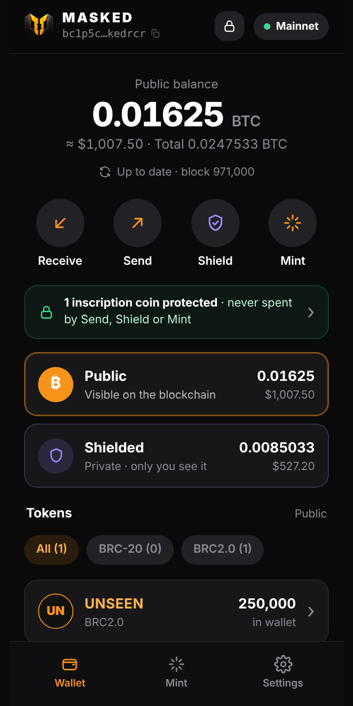 | 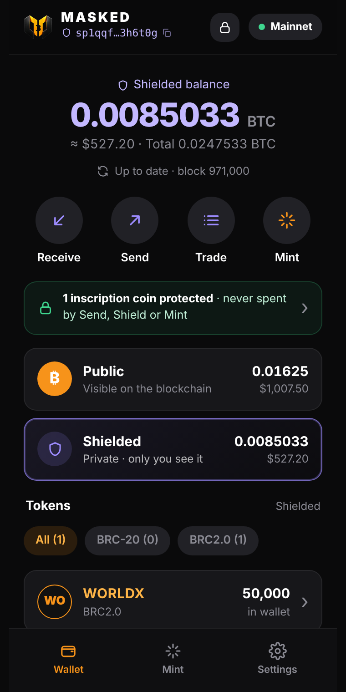 | 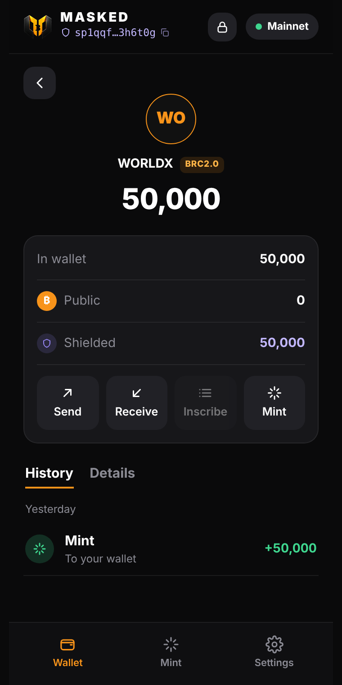 |
| **Receive privately** | **Trade from Shielded** | **List straight from Shielded** |
| 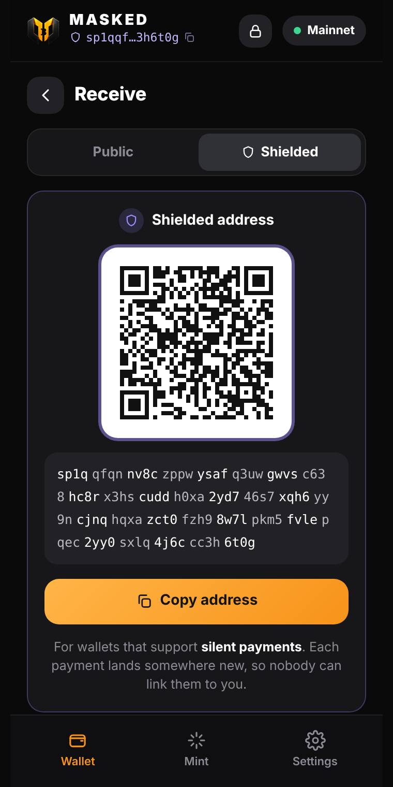 | 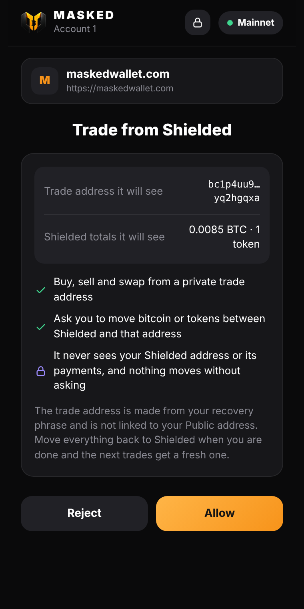 | 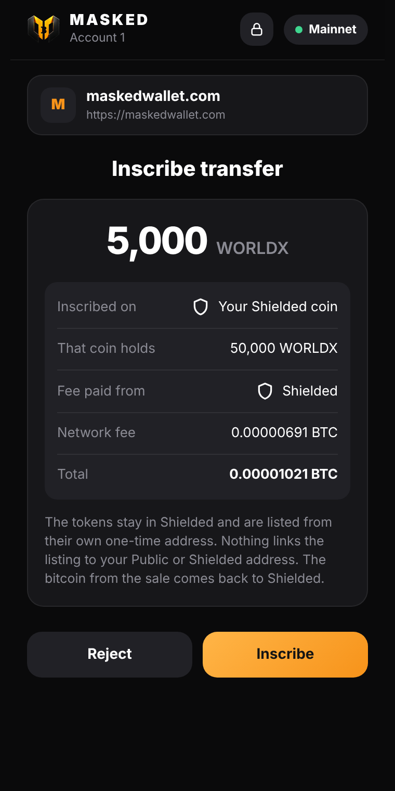 |
| **Ecash** (2.19) | **Locked to an address** (2.19) | **Pay a website with ecash** (2.19) |
| 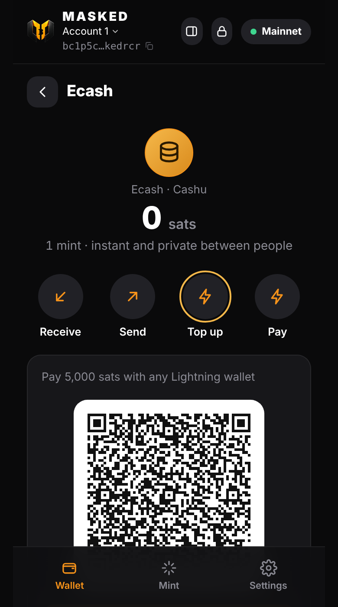 | 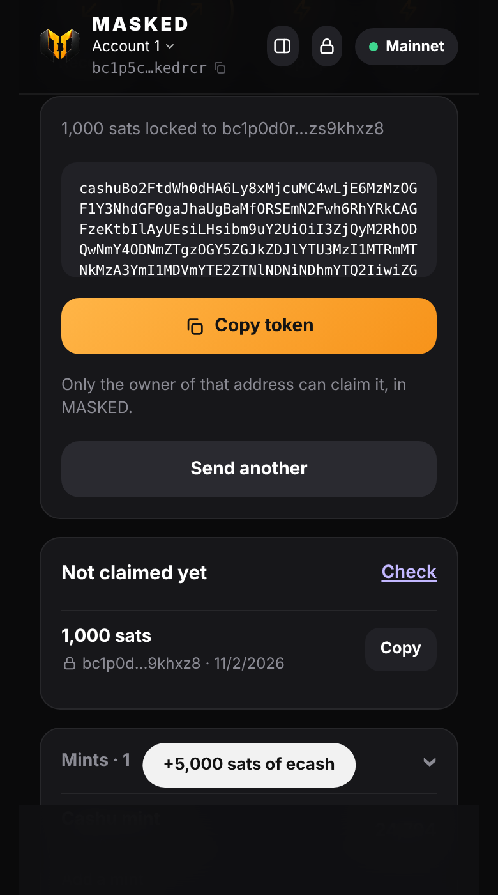 | 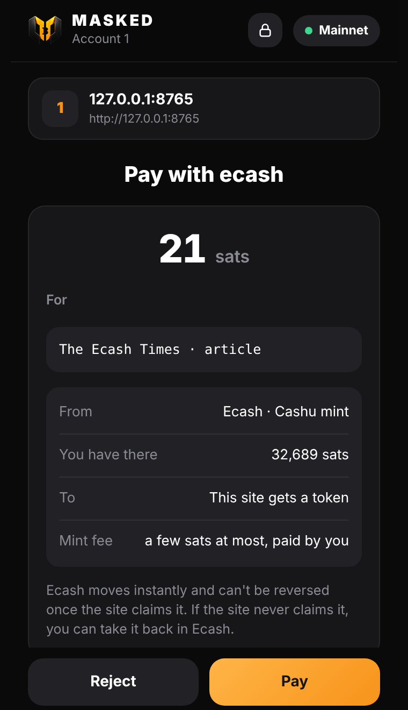 |
| **Ordinals** (2.21) | **One inscription** (2.21) | **Shield an ordinal** (2.21) |
| 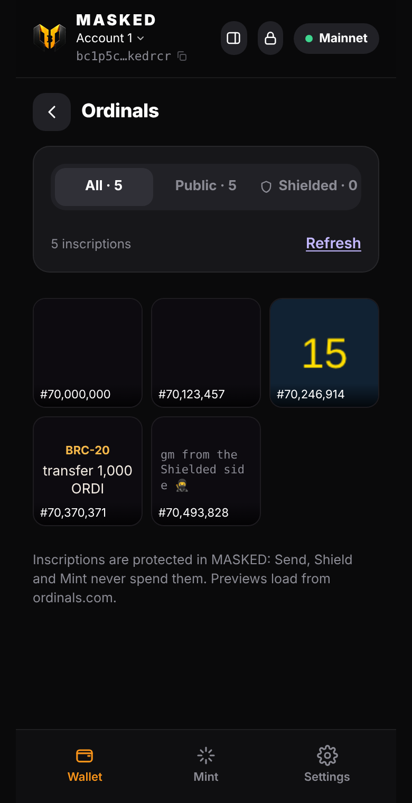 | 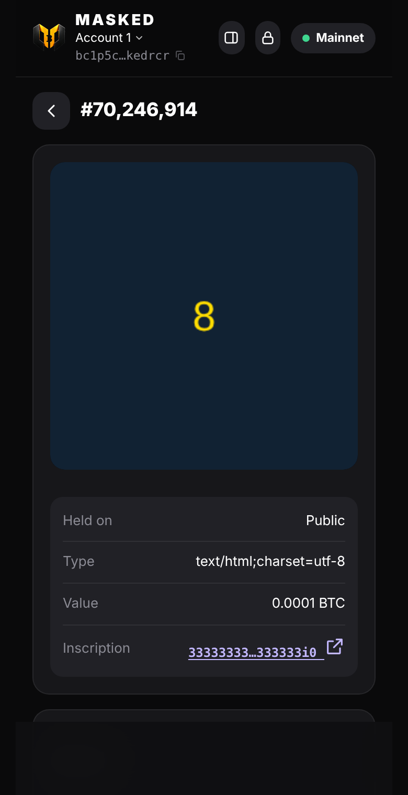 | 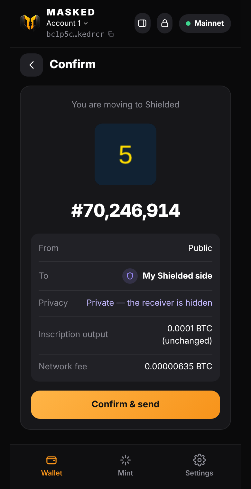 |
| **Offline send** (2.14) | **Silent airdrop** (2.15) | **Share on X** (2.14) |
| 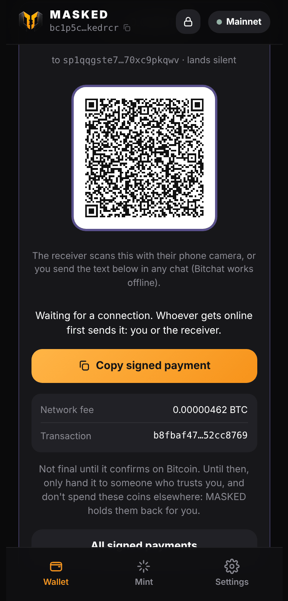 | 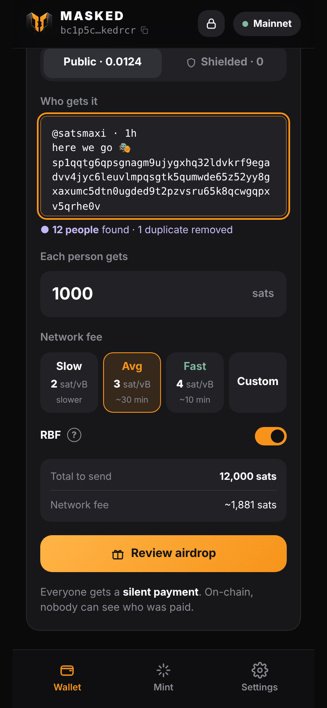 | 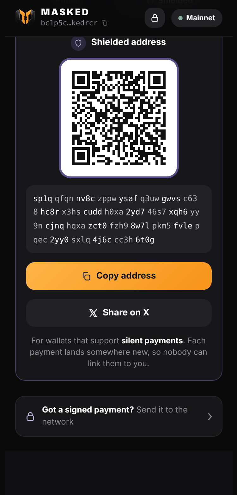 |

## Install

- **Chrome Web Store** (recommended, updates by itself): [MASKED Wallet](https://chromewebstore.google.com/detail/masked-wallet/pojmpfcbdmacabhckemelcbkmckhaoig). Works in Chrome, Brave and Edge.
- **From this repo:** open `chrome://extensions`, turn on Developer mode, press **Load unpacked** and pick the `extension/` folder.

## Build it yourself

Node 20+:

```sh
npm ci
npm run check   # lint, type check, and the tests (BIP 352 vectors, fast scanner, private trading, wallet services, offline send, airdrop, accounts, LEAF, ecash)
npm run build   # rebuilds extension/ from src/
```

The build is reproducible: the same source always gives the same `extension/`. The Chrome Web Store package is built from a tagged release, and only drops the manifest `key`.

| Version | What's new | Where |
|---|---|---|
| [`v2.12.9`](../../tree/v2.12.9) | the first Chrome Web Store version | GitHub |
| 2.13.0 | the same wallet, rewritten into classes and modules ([docs/ARCHITECTURE.md](docs/ARCHITECTURE.md)) | GitHub |
| [`v2.14.0`](../../tree/v2.14.0) | Offline send, Share on X | GitHub |
| [`v2.15.0`](../../tree/v2.15.0) | Silent airdrop | Chrome Web Store |
| [`v2.15.1`](../../tree/v2.15.1) | no scrollbar drawn in the popup (scroll with the trackpad or wheel, no wide grey bar on Windows) | GitHub |
| [`v2.16.0`](../../tree/v2.16.0) | several accounts from one phrase: add, rename, hide, switch (UniSat-compatible Public addresses) | GitHub |
| [`v2.18.0`](../../tree/v2.18.0) | LEAF (CRC-20): balances and sends, Public and Shielded | Chrome Web Store |
| [`v2.18.1`](../../tree/v2.18.1) | review fixes: locking reaches every open wallet window; confirmed Shielded change is spendable; Shielded LEAF lookups are opt-in; LEAF balances per account | GitHub |
| [`v2.18.2`](../../tree/v2.18.2) | small coins (1,000 sats or less) can be unlocked once ord confirms they're plain bitcoin; sends can use several coins; Reset coin list asks first and rescans since the wallet was created | GitHub |
| [`v2.18.3`](../../tree/v2.18.3) | security: look-alike address warnings, SIGHASH_NONE refused, big-move warnings, extension fingerprint to verify a release ([SECURITY.md](SECURITY.md)); LEAF reservations reconciled with the indexer | GitHub |
| [`v2.19.0`](../../tree/v2.19.0) | Ecash (Cashu): receive, send, lock to a `bc1p…` address with a 7-day refund, Lightning top up, pay Lightning invoices, restore from the phrase; `window.masked.cashu` for websites; [Taproot-lock spec](docs/NUT-taproot-lock.md) | GitHub |
| [`v2.20.0`](../../tree/v2.20.0) | **Top up ecash with BTC** (NUT-30 on-chain deposits): send from Public or Shielded to the mint, then pay any Lightning invoice. BTC → Lightning in the wallet, no swap service | GitHub |
| [`v2.20.1`](../../tree/v2.20.1) | Ecash suggests one mint, Minibits (the most used); any other mint can be added by address, with a link to mint reviews | GitHub |
| [`v2.20.2`](../../tree/v2.20.2) | Ecash Send: the lock note updates as you type; paywall demo hides its gate once paid | GitHub |
| [`v2.27.6`](../../tree/v2.27.6) | RGB opens with your last balances and tokens at once (saved on this browser) and updates them in the background, so a slow block server no longer leaves the list empty or an approval unable to find the token. Home shows "Last saved" until the refresh finishes | `main` |
| [`v2.27.5`](../../tree/v2.27.5) | Instant listings: the transaction that moves the tokens onto their own output is checked on the block servers after signing and sent to the next server if the first dropped it, and sent again on refresh until it confirms. Approvals wait for a running RGB refresh instead of failing with "RGB is busy" | |
| [`v2.27.4`](../../tree/v2.27.4) | Your own blockchain server (Settings) now gets every request while it answers, RGB included: RGB switches to it as soon as you save it (it used to stay on mempool.space until a reload) and goes back to it after a failover. Block pages are no longer spread over the public servers when you have your own | |
| [`v2.27.3`](../../tree/v2.27.3) | Settings: saving your own blockchain, scan or BRC-20 server shows Chrome's permission prompt again (it was asked too late and silently refused) and shows any error. Signet: memproxy.inscribe.dev is a built-in backup block server | |
| [`v2.27.2`](../../tree/v2.27.2) | Removed "Sell automatically" and its `offscreen` and `alarms` permissions: Instant listings already sell while the seller is offline. Its saved settings and the session key are cleared on update | |
| [`v2.27.1`](../../tree/v2.27.1) | Protocol 1.0 uploads also sign the earlier draft's message (UniSat's server refused the spec's with "Invalid endpoint auth signature"); a failed upload drops its colouring so the tokens stay spendable (`abandonColoring`). Needs the engine rebuilt | |
| [`v2.27.0`](../../tree/v2.27.0) | Pays RGB invoices whose transfer server speaks **RGB proxy protocol 1.0** (UniSat's, among others), keeping 0.2: the consignment is encrypted for the recipient (X25519 + XChaCha20-Poly1305), signed (Ed25519), with the proof of work the server asks for; checked byte for byte against the spec's examples and a Rust reference. Needs the engine rebuilt | |
| [`v2.26.5`](../../tree/v2.26.5) | Instant trades pay for their real size (about 298 vB for a purchase, not a flat 320), Signet RGB uses 1 sat/vB, and the approval shows the rate × size and the 330 sats that come back with the tokens | |
| [`v2.26.4`](../../tree/v2.26.4) | Fix: the buyer's token check read the engine's answer under the wrong names and refused every RGB purchase ("another token than the offer"); nothing was paid | |
| [`v2.26.3`](../../tree/v2.26.3) | RGB trades don't wait for the last trade's change to confirm: they can pay with this wallet's own unconfirmed change, and Instant buys and moves combine several coins when one isn't enough | |
| [`v2.26.2`](../../tree/v2.26.2) | Instant listings fixed: the RGB commitment is output 0 (RGB anchors to the first OP_RETURN or taproot output), the seller signs input 1 with its payout in output 1. Listings signed by 2.26.0/2.26.1 are flagged: cancel and list again | |
| [`v2.26.1`](../../tree/v2.26.1) | `rgb.getAssets()`: a site can show your RGB tokens to pick from (after you agree to share them), so sellers don't paste asset IDs | |
| [`v2.26.0`](../../tree/v2.26.0) | **Instant RGB listings**: the seller signs once (SIGHASH_SINGLE\|ANYONECANPAY, valid only if it's paid its price) and anyone's MASKED buys in one step, with the seller offline (`rgb.listInstant`, `buyInstant`, `cancelInstant`). Listed outputs are reserved in the engine; cancelling moves them | |
| [`v2.25.1`](../../tree/v2.25.1) | **Sell automatically** (opt-in): a listed RGB sale completes by itself when a buyer comes, while Chrome is open, for exactly the approved token, amount and price (`rgb.autoSell`, `rgb.stopAutoSell`). Runs in a hidden extension page; the RGB key stays in Chrome's session memory only | |
| [`v2.25.0`](../../tree/v2.25.0) | **RGB swaps, wallet to wallet**: tokens for BTC in one transaction, nobody in the middle (`window.masked.rgb`: prepareBuy, prepareSale, signBuy, completeSale; any wallet following the documented format can trade with MASKED). Needs the RGB engine with swaps: [engine/](engine/README.md) | |
| [`v2.24.0`](../../tree/v2.24.0) | **RGB for websites**: `window.masked.rgb.requestInvoice` and `rgb.payInvoice`, each approved in MASKED (English and 简体中文) ([PROVIDER.md](docs/PROVIDER.md#rgb-tokens-masked-only)) | |
| [`v2.23.3`](../../tree/v2.23.3) | Chinese: the sync status (restoring history, scanning) is translated, and Settings → Language highlights the chosen language | |
| [`v2.23.2`](../../tree/v2.23.2) | 简体中文 everywhere: Mint and deploy, BRC-20 and BRC2.0, Ordinals, ecash, LEAF, RGB (send, receive, create, backups), airdrops, signed payments, website approvals and the error messages (959 lines, still a draft for review) | |
| [`v2.23.1`](../../tree/v2.23.1) | RGB no longer depends on mempool.space alone: it tries your own block server (Settings), then mempool.space, then blockstream.info, and switches when one stops answering. Fixes "Invalid indexer: not a valid esplora server" when mempool.space is busy or blocked | |
| [`v2.23.0`](../../tree/v2.23.0) | **简体中文 (Simplified Chinese, beta)**: Settings → Language · 语言; English stays the default. Setup, unlock, Home, Send, Shield, Receive, coins, accounts and Settings are translated; other screens follow. The translation is a draft for native speakers to review: [docs/i18n](docs/i18n/TRANSLATING.md). Chrome Web Store name and description in Chinese | |
| [`v2.22.10`](../../tree/v2.22.10) | RGB send: the fee picker is on the send form too, with the current mempool rates, not only on the review | |
| [`v2.22.9`](../../tree/v2.22.9) | RGB send: the review has a Slow / Avg / Fast / Custom fee picker with fresh rates (whole sat/vB, up to 500) instead of silently using the last rate | |
| [`v2.22.8`](../../tree/v2.22.8) | RGB: turning RGB on or allowing a transfer server from the toolbar never opens a second MASKED window: if the popup stayed open it carries on, otherwise only the popup is reopened | |
| [`v2.22.7`](../../tree/v2.22.7) | RGB: a payment an earlier beta counted twice is taken off "Available to send" only when its coin is spendable; on a coin a pending send or invoice locks, the engine already leaves it out | |
| [`v2.22.6`](../../tree/v2.22.6) | RGB: when the engine refuses to cancel a transfer, MASKED shows the real reason; a send that lost its signed transaction in a restore is marked as stuck (it can be neither finished nor cancelled with RGB engine 1.0.0-beta.3) instead of offering a Cancel that can only fail | |
| [`v2.22.5`](../../tree/v2.22.5) | RGB: a send signed before the wallet was restored can't be broadcast (the engine's backups don't keep the signed transaction); MASKED now says so on that transfer and offers Cancel, and Settings warns before moving a wallet with a transfer in flight | |
| [`v2.22.4`](../../tree/v2.22.4) | RGB: a transfer the other wallet hasn't accepted yet shows as Sending (not on mempool until then) and can be cancelled, which frees its tokens; the token page says what holds locked tokens | |
| [`v2.22.3`](../../tree/v2.22.3) | allowing an RGB transfer server from the toolbar takes one Chrome approval: MASKED reopens at the same step by itself, with no extra window | |
| [`v2.22.2`](../../tree/v2.22.2) | signing review: a SIGHASH_SINGLE\|ANYONECANPAY signature can't hide behind another input's ALL signature, and always needs the confirm box; RGB invoices can only be shown or copied once a confirmed backup holds them, and a plain download no longer counts as a backup; allowing an RGB transfer server from the toolbar continues in a small wallet window placed inside the browser window (a tab in full screen) | |
| [`v2.22.1`](../../tree/v2.22.1) | security review fixes: website signing requests show which outputs your signature covers, leave outputs it doesn't cover out of the balance change and ask before signing; signature types from websites must be standard values (no markup on the approval screen); RGB backs up an invoice before showing it, and a backup file counts only once it's written | |
| [`v2.22.0`](../../tree/v2.22.0) | **RGB tokens on Bitcoin mainnet (beta, opt-in)**: hold, receive, send and create RGB tokens (NIA), works with other RGB 0.11 wallets; RGB has keys of its own; **encrypted cloud backup** (signed and versioned, on by default, can be switched off) plus backup files; invoice list. RGB servers are asked for only when RGB is turned on | |
| [`v2.21.1`](../../tree/v2.21.1) | Ecash: the look-alike address check for locked tokens is a tick box inside MASKED, not a browser pop-up | |
| [`v2.21.0`](../../tree/v2.21.0) | Ordinals gallery on both sides (images, text, BRC-20), and send an inscription to any address or **privately to a Shielded address**: the inscription keeps its own output and value, and the fee comes only from plain coins of the same side | |
| [`v2.20.3`](../../tree/v2.20.3) | Ecash: claim a token before adding any mint (MASKED adds it); the claim toast no longer shows the sender's fee | |
| [`v2.15.2`](../../tree/v2.15.2) | redesigned unlock screen (show-password button, clearer wrong-password state); a side panel button in the header | GitHub |

## Use it from your website: `window.masked`

MASKED injects `window.masked` into every page. It follows UniSat's `window.unisat`, so most dApps work with a one-line change.

```js
const wallet = window.masked ?? window.unisat;
if (!wallet) location.href = 'https://chromewebstore.google.com/detail/masked-wallet/pojmpfcbdmacabhckemelcbkmckhaoig';

// connect (opens an approval the first time)
const [address] = await wallet.requestAccounts();
const network = await wallet.getNetwork();          // 'livenet' or 'testnet' (Signet)
const { total } = await wallet.getBalance();        // sats on the Public address

// sign a message
const sig = await wallet.signMessage('hello', 'bip322-simple');

// pay, also to a silent payment (sp1…) address
const txid = await wallet.sendBitcoin('sp1qq…', 10_000);

// sign a PSBT (e.g. a marketplace listing with SIGHASH_SINGLE|ANYONECANPAY)
const signed = await wallet.signPsbt(psbtHex, { autoFinalized: true, toSignInputs: [{ index: 1, address, sighashTypes: [0x83] }] });
await wallet.pushPsbt(signed);

// BRC-20: inscribe a transfer, ready to list or send
const { inscriptionId } = await wallet.inscribeTransfer('ordi', '100');

// MASKED extras
const shielded = await wallet.getShieldedAddress();   // sp1… (receive privately)

// ecash (Cashu): ask for 21 sats as a token, then redeem it at the mint on your server
const { token } = await wallet.cashu.pay({ amount: 21, memo: 'Article #42' });
await wallet.cashu.payRequest('creqA…');              // or pay a NUT-18 payment request

wallet.on('accountsChanged', (accounts) => {});
wallet.on('networkChanged', (network) => {});
```

Wait for the provider if your script runs early:

```js
window.addEventListener('masked#initialized', () => start(window.masked), { once: true });
```

Every call that signs, pays or inscribes opens an approval in the MASKED popup that shows your site's name. Errors carry a `code`: `4001` rejected by the user, `4100` not connected, `4200` not supported, `4000` anything else.

Full reference: [docs/PROVIDER.md](docs/PROVIDER.md). A test page that calls every method: [examples/demo.html](examples/demo.html). An ecash paywall: [examples/cashu-paywall.html](examples/cashu-paywall.html) (serve them over http(s)).

### Private trading

maskedwallet.com can trade from the Shielded balance: `getTradeAccount()`, `fundTradeAccount()`, `moveToTradeAccount()`, `returnToShielded()`, `cancelShieldedListing()` and `inscribeTransfer(ticker, amount, { account: 'shielded' })`. The site sees a private trade address and Shielded totals, never the Shielded address or its payments. These are limited to maskedwallet.com for now; see [docs/PROVIDER.md](docs/PROVIDER.md#private-trading-masked-only).

## How it works

The wallet is a set of small classes wired together by one composition root (`src/app/MaskedApp.mjs`). Full map: [docs/ARCHITECTURE.md](docs/ARCHITECTURE.md).

| Folder | What it does |
|---|---|
| `src/crypto/` | BIP 352 silent payments (`sp-core.mjs`, pure, checked against the official vectors) and the WebAssembly scanner. |
| `src/bitcoin/`, `src/ordinals/` | Addresses, taproot, hand-built transactions and signatures; inscription envelopes and BRC-20 / BRC2.0 rules. |
| `src/wallet/` | Keys, coins and their protection, sends and inscriptions, offline-signed payments, silent airdrops, the encrypted vault. |
| `src/scan/` | Finding Shielded payments: the private check, worker threads, and syncing with the chain. |
| `src/tokens/`, `src/trade/` | Token balances and transactions; private trading from Shielded. |
| `src/dapp/`, `src/provider/` | `window.masked`: approvals and PSBT signing in the wallet; `inpage.js`, `content.js` and `background.js` (routing, never holds keys). |
| `src/ui/` | One class per screen, a renderer and one input controller. |
| `extension-template/` | Manifest assets: page shell, icons. |

Keys stay in the browser: the recovery phrase is stored only as an AES-256-GCM vault (PBKDF2, 600,000 iterations). The background script and websites never see keys. Shielded scanning downloads public block data and never sends the scan key anywhere.

## Contributing and security

Pull requests are welcome: see [CONTRIBUTING.md](CONTRIBUTING.md). Please report security issues privately as described in [SECURITY.md](SECURITY.md).

## License

[MIT](LICENSE)

## RGB tokens (mainnet beta)

On **mainnet**, Home offers **RGB tokens (beta)**: an opt-in section to hold, receive, send and create RGB tokens. RGB uses keys of its own, derived from the recovery phrase on a separate path, so its coins never mix with Public or Shielded BTC. RGB tokens can't come back from the phrase alone, so MASKED keeps an encrypted, signed cloud backup (switch it off in Settings → RGB (beta)) and can save backup files. Beta: keep amounts small. Details: [RGB-SIGNET.md](docs/RGB-SIGNET.md#mainnet-beta-encrypted-cloud-backup).

## RGB Signet prototype

On **Signet**, Settings → **RGB** enables RGB test assets in the existing Wallet, Receive and Send screens, with encrypted RGB backup/restore. Utexo custom Signet funding remains separate from public Bitcoin Signet. Test assets only; no real USDT. See [the setup and manual test guide](docs/RGB-SIGNET.md).
