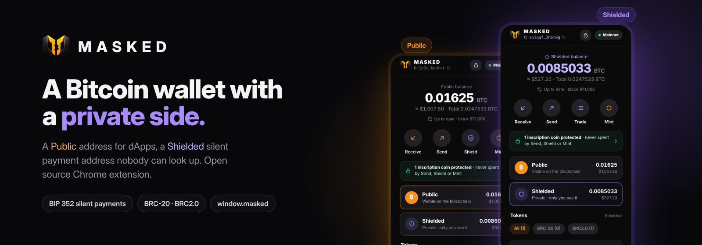
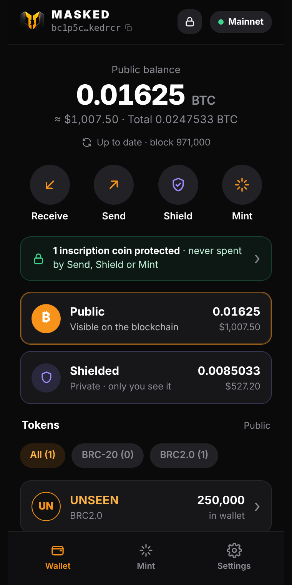
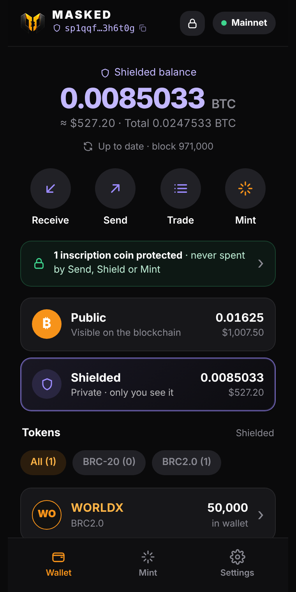
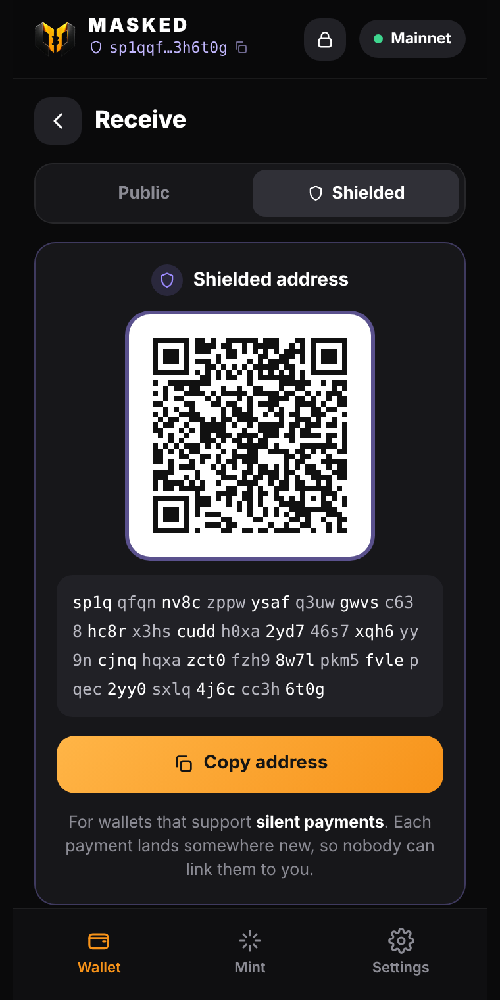
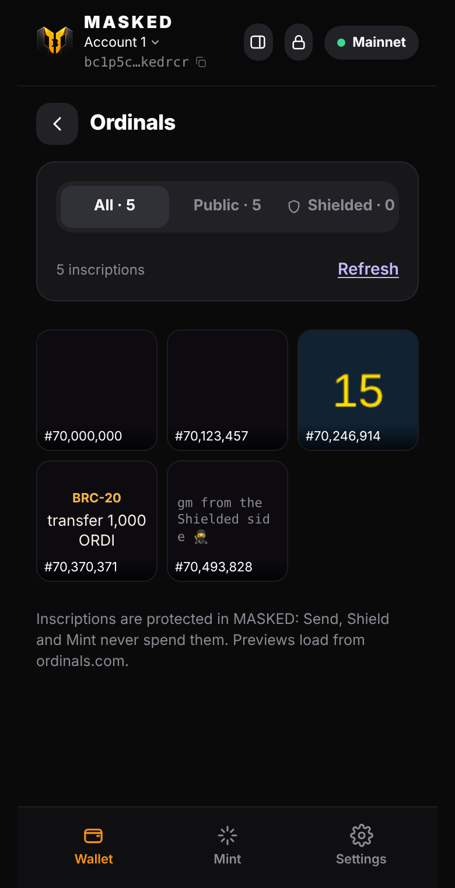
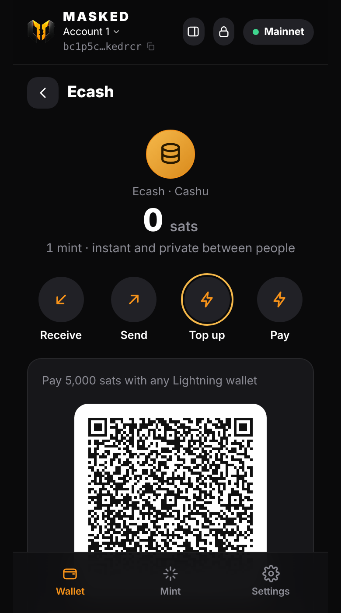
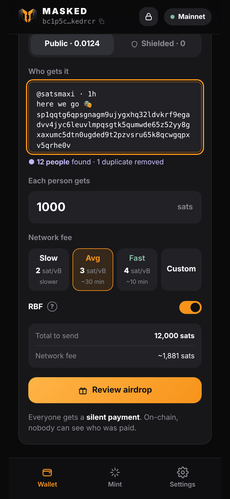
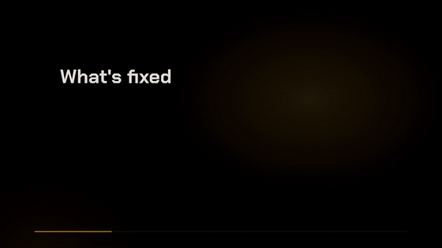

<p align="center"></p>

# MASKED

[](https://t.me/maskedwallet) [](https://x.com/ratsonchain) [](LICENSE) [](docs/README.md) [](https://deepwiki.com/buildOrDie/masked-wallet)

**A Bitcoin wallet with a private side.** Open source, for Chrome and Android.

You get two Bitcoin balances from one recovery phrase:

- **Public**: a normal address (`bc1p…`) for exchanges, marketplaces and websites.
- **Shielded**: a private address (`sp1…`) you can share anywhere. Every payment to it lands somewhere new, so nobody can look up what you hold or link your payments ([silent payments, BIP 352](https://github.com/bitcoin/bips/blob/master/bip-0352.mediawiki)).

It also holds your tokens and NFTs: BRC-20, Ordinals, RGB and LEAF, plus Cashu ecash for instant payments.

[**Add to Chrome**](https://chromewebstore.google.com/detail/masked-wallet/pojmpfcbdmacabhckemelcbkmckhaoig) · [**Android app**](https://signet.maskedwallet.com/install) · [maskedwallet.com](https://maskedwallet.com) · [the dev on X: @ratsonchain](https://x.com/ratsonchain)

**New here?** [Getting started](docs/GETTING-STARTED.md) · [FAQ](docs/FAQ.md) · [News and videos](docs/NEWS.md) · [All guides](docs/README.md) · [Ask the AI wiki](https://deepwiki.com/buildOrDie/masked-wallet) (answers questions about MASKED and its code)

> **Experimental, unaudited software. Use small amounts.** See [Safety](#safety) and [SECURITY.md](SECURITY.md).

| Public | Shielded | Receive privately |
|:-:|:-:|:-:|
|  |  |  |
| **Ordinals** | **Ecash** | **Pay many people at once** |
|  |  |  |

## Get it

| | How | Updates |
|---|---|---|
| **Chrome, Brave, Edge** | [Chrome Web Store](https://chromewebstore.google.com/detail/masked-wallet/pojmpfcbdmacabhckemelcbkmckhaoig) | By themselves |
| **Android** (test build) | Download the APK from [signet.maskedwallet.com/install](https://signet.maskedwallet.com/install) or [Releases](../../releases). Not on Google Play yet, so Android asks you to allow the install once. | The app tells you when a new version is out |
| **From this repo** | `chrome://extensions` → turn on Developer mode → **Load unpacked** → pick the `extension/` folder | By hand |

To check a download is genuine, compare its SHA-256 with the one on the release page.

## What you can do

| | What it does | Guide |
|---|---|---|
| **Send and receive** | Bitcoin on the Public or the Shielded side. Paying an `sp1…` address works from either side. | |
| **Shield** | Move bitcoin from Public to Shielded, where nobody can follow it. | |
| **Tokens** | BRC-20 and BRC2.0: mint, deploy, inscribe, send. LEAF (CRC-20): balances and sends, also privately. | [LEAF](docs/LEAF.md) |
| **Ordinals** | See your inscriptions and send them, also privately to a Shielded address. | [Ordinals](docs/ORDINALS.md) |
| **RGB tokens** | Hold, receive, send and create RGB tokens, and trade them on [the market](https://signet.maskedwallet.com/rgb). Signet (test coins) and a Mainnet beta. | [RGB](docs/RGB-SIGNET.md) |
| **Ecash** | Cashu ecash for instant, private payments in any chat. Top up with bitcoin or Lightning, lock a token to an address. | [Ecash](docs/ECASH.md) |
| **Offline send** | Sign a payment with no internet and hand it over as a QR code or text. It's sent when either side gets online. | [Offline](docs/OFFLINE.md) |
| **Silent airdrop** | Paste a list of Shielded addresses (even a whole X thread) and pay everyone in one transaction. | [Airdrop](docs/AIRDROP.md) |
| **Several accounts** | Add, rename, hide and switch accounts from one recovery phrase. | [Accounts](docs/ACCOUNTS.md) |
| **Languages** | English and 简体中文 (draft: [help review it](docs/i18n/TRANSLATING.md), no coding needed). | |

## How the balances fit together

| Balance | What it's for | Address |
|---|---|---|
| **Public** | Everyday Bitcoin, websites, marketplaces. Anyone can see it, like any Bitcoin address. | `bc1p…` (`tb1p…` on Signet) |
| **Shielded** | Private Bitcoin. Nobody can look up what it holds. | `sp1…` (`tsp1…` on Signet) |
| **RGB balance** | Bitcoin set aside for buying RGB tokens and paying RGB's network fees. It's kept apart so an ordinary send can never spend an output that holds tokens. Use **Add from Bitcoin** and **Move to Bitcoin** on Home. | Shown in Settings → RGB, for support |
| **Ecash** | Cashu tokens issued by a mint you choose. | none: ecash is a token, not an address |

## Safety

- **Your keys stay on your device.** The recovery phrase is stored only encrypted (AES-256-GCM, PBKDF2 with 600,000 iterations). Websites never see your keys; every signature or payment needs your approval in MASKED.
- **Ecash is held by its mint.** The mint you choose holds the bitcoin behind your ecash, so ecash is custodial. Keep ecash amounts small.
- **RGB needs its own backup.** Your recovery phrase alone can't bring RGB tokens back. MASKED keeps an encrypted cloud backup (on by default) and can save backup files. RGB on Mainnet is a beta: keep amounts small.
- **Signet is for testing.** Coins and tokens on Signet have no value.
- Found a security problem? Report it privately: [SECURITY.md](SECURITY.md).

## What's new

<p align="center"><a href="docs/img/masked-2.29.28.mp4"></a><br><a href="docs/img/masked-2.29.28.mp4"><b>▶ Watch the 2.29.28 video (20 s)</b></a> · <a href="docs/NEWS.md">All news and videos</a></p>

- **2.29.28**: switching between Mainnet and Signet while a scan is running no longer mixes the two up (Signet kept loading); wallets it already happened to repair themselves.
- **2.29.27**: Home shows a one-time note that MASKED is free, open source and built in public, with a link to follow the dev on X. Settings has links to the dev's X and to this repository.
- **2.29.26**: faster, with far fewer network requests: windows opened from a site share their work, and open listings are checked for a sale at most every 2 minutes. Fixes a step that could hang for good, and lots that lost their signature when browser storage filled up.
- **2.29.25**: **lots on sale at once**: one approval moves and signs every lot, so they're all for sale even with MASKED closed right after.
- **2.29.24**: lots work with tokens from swaps too; RGB pauses token moves while another copy of the wallet is newer, and offers to load its backup.
- **2.29.23**: **sell in lots**: split a sale into up to 10 Instant listings in one transaction; buyers take as many as they want, the rest stays listed.
- **2.29.22**: buy several Instant listings at once (a sweep).
- **2.29.20**: an **RGB balance** on Home that you can add to and move back to Bitcoin (also moves the small leftover RGB outputs). Buying with too little in it now offers to add exactly what's needed.
- **2.29.19**: the Android app no longer installs its own updates (Google Play Protect blocks apps that do); it opens the download page instead.
- **2.29.12–2.29.17**: the **Android app**: a Market tab with MASKED's RGB market and Launchpad, and fixes for older phones (copy, paste, RGB, buying).

Every version: [CHANGELOG.md](CHANGELOG.md).

## For developers

### Connect your website: `window.masked`

MASKED adds `window.masked` to every page. It follows the same API as `window.unisat`, so most Bitcoin dApps work with a one-line change.

```js
const wallet = window.masked ?? window.unisat;
const [address] = await wallet.requestAccounts();          // connect (asks the person the first time)
const txid = await wallet.sendBitcoin('sp1qq…', 10_000);     // pay, also to a Shielded address
const shielded = await wallet.getShieldedAddress();          // the person's sp1… address
const { token } = await wallet.cashu.pay({ amount: 21 });   // ecash
```

Every call that signs or pays opens an approval in MASKED. Full reference, RGB and private trading included: [docs/PROVIDER.md](docs/PROVIDER.md). A test page for every method: [examples/demo.html](examples/demo.html).

### Build it

Node 20+:

```sh
npm ci
npm run check   # lint, type check and every test
npm run build   # rebuilds extension/ from src/
```

The build is reproducible: the same source gives the same `extension/`. The Chrome Web Store package is built from a tagged release and only drops the manifest `key`. RGB swaps need the engine built with [engine/build.sh](engine/README.md). Android and iPhone: [docs/ANDROID.md](docs/ANDROID.md), [docs/IOS.md](docs/IOS.md). How the code is laid out: [docs/ARCHITECTURE.md](docs/ARCHITECTURE.md).

### Working with an AI assistant

- **Questions about MASKED or its code:** ask the [AI wiki on DeepWiki](https://deepwiki.com/buildOrDie/masked-wallet).
- **Coding agents** (Claude Code, Codex, Cursor, Copilot…) read [AGENTS.md](AGENTS.md): commands, where things are, and the rules that keep wallet code safe.
- **Chat assistants and search tools** can read [llms.txt](llms.txt), a short map of MASKED and its docs.

## Follow the build

MASKED is built in public. Every release, fix and what's coming next is posted first by its developer on X: **[@ratsonchain](https://x.com/ratsonchain)**. Questions and support: the Telegram chat, [t.me/maskedwallet](https://t.me/maskedwallet). Found a bug? Open an [issue](https://github.com/buildOrDie/masked-wallet/issues).

## Contributing

Pull requests are welcome: see [CONTRIBUTING.md](CONTRIBUTING.md). Translations too: [docs/i18n](docs/i18n/TRANSLATING.md).

## License

[MIT](LICENSE)
