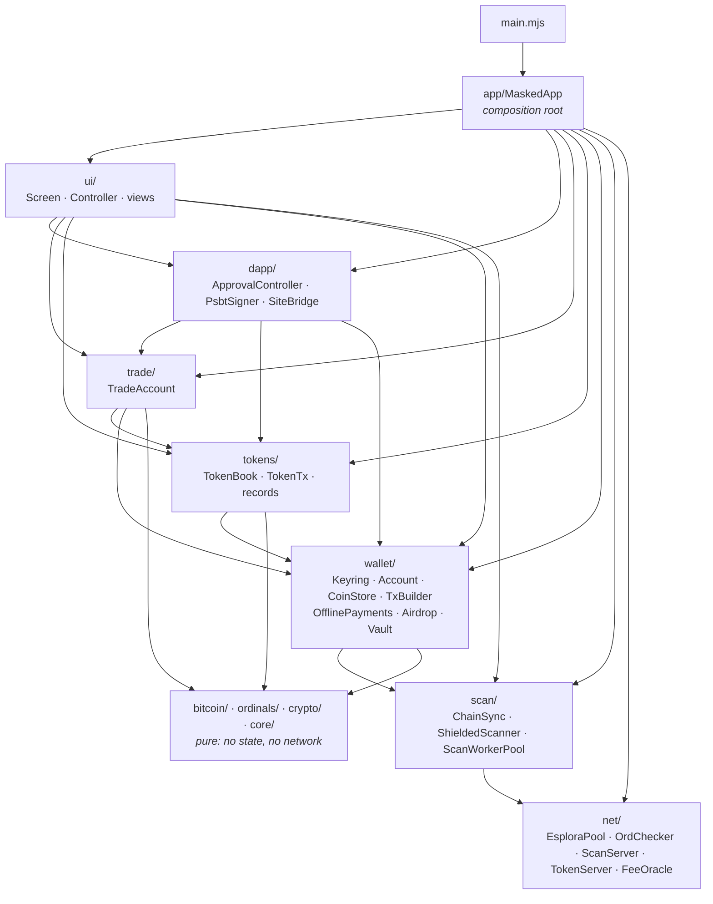
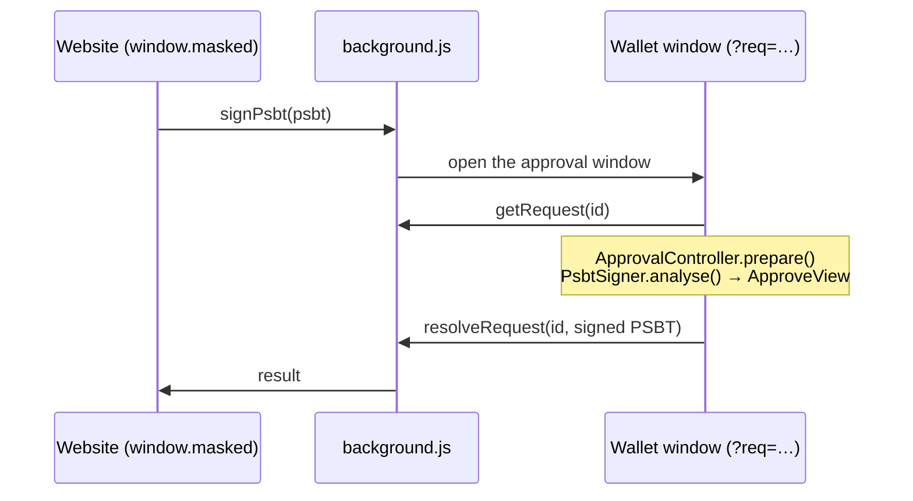

# Architecture

MASKED is plain JavaScript (ES modules), bundled by esbuild into the extension. There is no framework: views
are classes that return HTML strings, and one controller routes clicks. Types are checked from JSDoc
(`npm run typecheck`).

## Layers

| Folder | What lives there |
|---|---|
| `src/core/` | Bytes, formatting and parsing, `LocalStore` (localStorage that never throws). |
| `src/crypto/` | `sp-core.mjs`: BIP 352, checked against the official vectors. `sp-fast.mjs`: the same scan in WebAssembly libsecp256k1. |
| `src/bitcoin/` | Networks and explorers, `AddressCodec`, taproot outputs, `RawTransaction` (serialization, txid, BIP 341 signatures), `parseTx` (strict raw-transaction reader), message signing. |
| `src/ordinals/` | Inscription envelopes (write and read) and BRC-20 / BRC2.0 rules. |
| `src/net/` | The servers: Esplora failover (`EsploraPool`), ord checks, the scan server, the token server, fees and price. |
| `src/scan/` | Finding Shielded payments: the private check (`ShieldedScanner`), worker threads, and `ChainSync` (balance, new blocks, history). |
| `src/wallet/` | `Keyring` (keys), `Account` (the open wallet on the current network), `CoinStore` (coins and protection), `InscriptionIndex`, `TxBuilder` (sends and inscriptions), `OfflinePayments` (payments signed offline: reserved coins, sending when online, relaying payments others signed), `Airdrop` (one transaction to many Shielded addresses), `Vault` (encryption and session). |
| `src/tokens/` | `TokenBook` (balances, history, token-server checks), `TokenTx` (mints, deploys, sends, transfer inscriptions) and the records kept per wallet. |
| `src/trade/` | Private trading: `trade-core.mjs` (pure) and `TradeAccount` (trade address, Shielded listings, holders). |
| `src/dapp/` | `window.masked` requests: the approval window, PSBT analysis and signing, what connected sites may see. |
| `src/ui/` | `Screen` renders the current `View`; `Controller` handles input; `views/` has one class per screen. |
| `src/app/` | `MaskedApp` builds and wires everything; `AppState` (what the screens show), `LockController` (unlock, onboarding, auto-lock), `Platform` (chrome.* and the phone app). |
| `src/provider/` | The dApp provider: `inpage.js` (`window.masked`), `content.js` (bridge), `background.js` (routing, approvals; never holds keys). |

## Rules the code follows

- **One composition root.** `MaskedApp` creates every service once and passes itself in; a service reaches
  its neighbours as `this.app.coins`, `this.app.tokens`, … There are no other globals.
- **Pure where possible.** `core/`, `crypto/`, `bitcoin/`, `ordinals/` and `trade/trade-core.mjs` hold no state
  and do no network calls, so they are tested directly in Node.
- **Services own their data.** Coins live in `CoinStore`, sync progress in `ChainSync`, records in `tokens/records.mjs`,
  trade state in `TradeAccount`, signed-but-unsent payments in `OfflinePayments`. `AppState` only holds UI state: the view, form fields, flows in progress.
- **Storage keys never change.** Every key keeps the `wren.` prefix and per-wallet id (`net:Bscan:Bspend`) of
  earlier versions, so upgrading keeps everyone's coins, records and settings.
- **Views render, the controller acts.** A view never changes state; a click goes to `Controller`, which calls a
  service and re-renders.
- **Keys stay in the page.** The background script and websites never see keys. Shielded scanning never sends the scan
  key anywhere: the scan server only answers requests for public block data.

## A request from a website

## Testing

- `npm test`: BIP 352 vectors (2,468 checks), the WebAssembly scanner, private trading, and the wallet services
  run in Node on the real classes (see `test/helpers/wallet-app.mjs`):
  - `test/wallet.test.mjs`: keys, addresses, sends, coin protection, PSBT signing, the token server.
  - `test/offline.test.mjs`: a payment signed offline and relayed by another wallet. The receiver's scan finds it. Covers "already on the network" and "coins spent elsewhere".
  - `test/airdrop.test.mjs`: addresses found in a pasted thread. Every recipient's own scan finds its coin, on Mainnet and Signet. Shielded change comes back. Clear errors.
- `npm run lint` and `npm run typecheck`: undefined names, wrong imports, and calls to methods that do not exist.
- `npm run check` runs all three.
