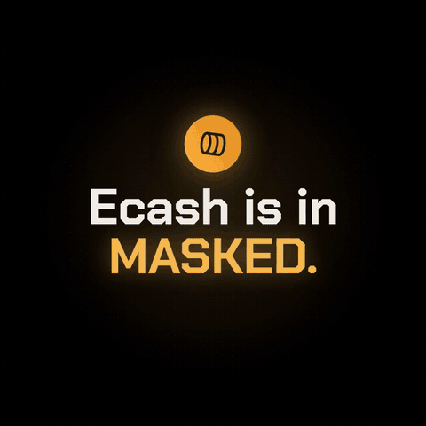
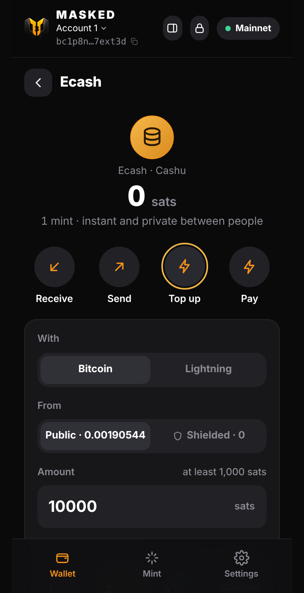
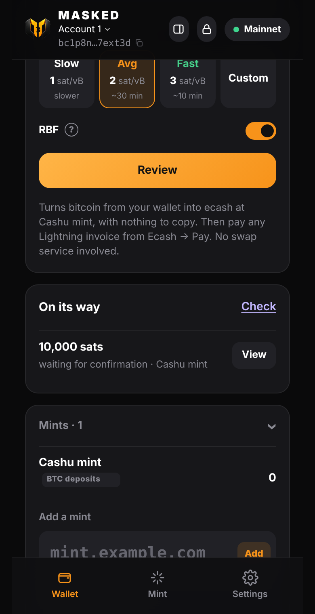
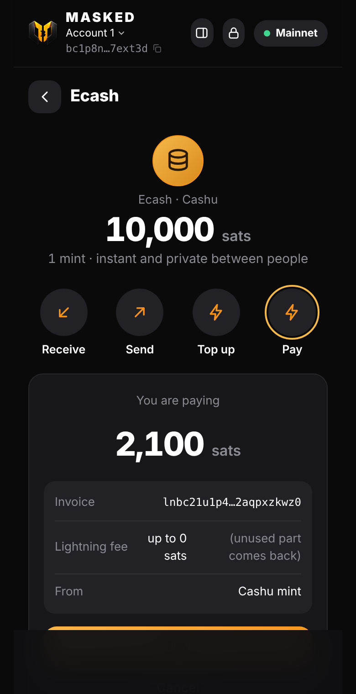
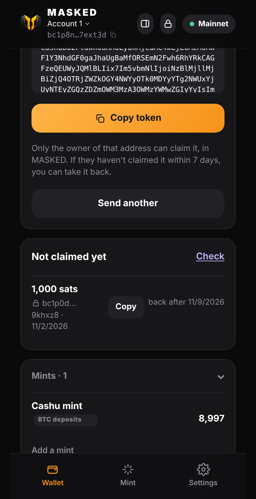
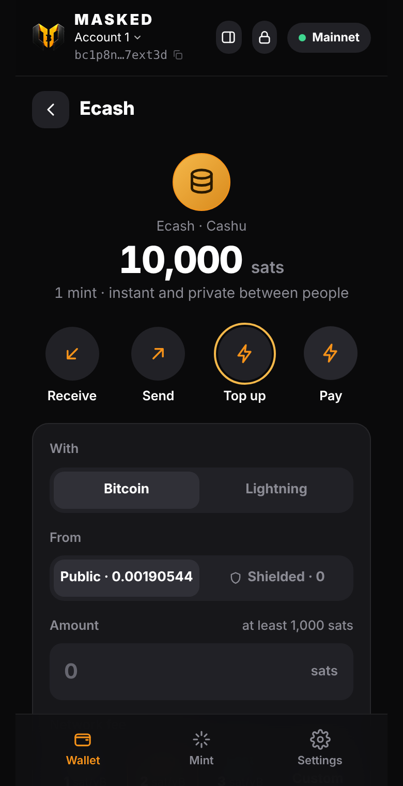
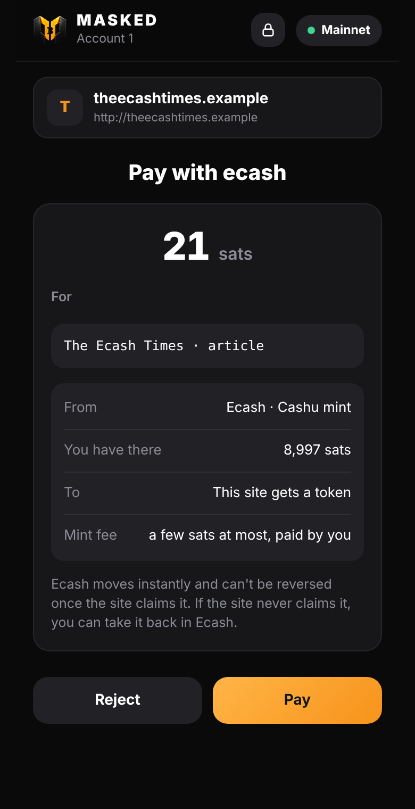

# Ecash (Cashu) in MASKED

<p align="center"><a href="img/masked-ecash.mp4"></a><br><a href="img/masked-ecash.mp4"><b>▶ Watch the video (47 s)</b></a></p>

| Top up with BTC | On its way | Pay Lightning |
|:-:|:-:|:-:|
|  |  |  |
| **Locked to a bc1p address** | **Ecash balance** | **A website asks, you approve** |
|  |  |  |

<sub>Screens from the test setup; BTC → ecash was also run on mainnet with Minibits.</sub>

Ecash is bitcoin as bearer tokens, issued by a **mint** ([Cashu](https://cashu.space)). It's instant, and private between
people: the mint signs tokens blind, so it can't link who paid whom.

**Ecash is an IOU from the mint you choose.** The mint holds the bitcoin behind it. Keep amounts small;
for savings, use Shielded. MASKED doesn't run or vouch for any mint.

## What you can do

| | |
| --- | --- |
| **Receive** | Paste a `cashuA…`/`cashuB…` token. MASKED swaps it at its mint for fresh ecash only you know. |
| **Send** | Make a token for any amount and share it in any chat or as a QR code. The receiver gets exactly that amount (the mint's fee is included). Until someone claims it, you can take it back. |
| **Lock to an address** | Lock a token to someone's `bc1p…` address. Only that address's key can claim it, so a copied or intercepted token is useless. If they don't claim it within 7 days, you can take it back. Your own lock address is your Public address. Spec: [NUT-taproot-lock.md](NUT-taproot-lock.md). |
| **Top up with Bitcoin** | With a mint that takes on-chain deposits ([NUT-30](https://cashubtc.github.io/nuts/)), MASKED sends from your Public or Shielded balance to the mint's deposit address, with nothing to copy. Once it confirms, the same amount arrives as ecash, and you can pay any Lightning invoice with it: **BTC → Lightning inside the wallet, with no swap service**. The deposit address is locked to a key of its own (NUT-20), so only this wallet can mint from it. Deposits show under "On its way" and are watched even after you close and reopen MASKED. |
| **Top up with Lightning** | Get a Lightning invoice from your mint, pay it from any Lightning wallet or exchange, and receive the same amount as ecash. |
| **Pay** | Pay any Lightning invoice with ecash. The unused part of the fee reserve comes back. |
| **Pay websites** | Sites ask through `window.masked.cashu` (pay, NUT-18 payment requests, refunds), and you approve each payment in MASKED. See [PROVIDER.md](PROVIDER.md#ecash-cashu-masked-only) and [`examples/cashu-paywall.html`](../examples/cashu-paywall.html). |
| **Find my ecash again** | After reinstalling, or on a new device with the same recovery phrase, ask your mints for the ecash this wallet made. |

## How it works

- **Storage:** proofs are stored encrypted (AES-GCM) with a key derived from this account's private key. Nothing about
  your ecash is readable in browser storage.
- **Restore:** outputs are deterministic ([NUT-13](https://github.com/cashubtc/nuts/blob/main/13.md)) from a seed derived
  per account from your recovery phrase, so a restore finds them again. The counters are kept with the proofs.
- **Locking:** a `bc1p…` address holds a 32-byte x-only key. A token locked to it uses
  [NUT-11](https://github.com/cashubtc/nuts/blob/main/11.md) P2PK with the key `02 || x`. The owner claims it with a
  BIP-340 signature from the address's key-path key. A NUT-11 locktime and a refund key of the sender are added, so an
  unclaimed token comes back after 7 days. Note that the mint sees the lock key when the token is claimed.
- **Mints:** MASKED only talks to the mints you add, and Chrome asks you before each new one. Mints must use https.
- **On-chain deposits** need a mint that offers the `onchain` mint method and NUT-20. MASKED shows "Top up with Bitcoin" only for those, and Lightning top-up stays available everywhere. While a deposit waits for its confirmation, the mint holds the bitcoin, as with any ecash.
- Built on [cashu-ts](https://github.com/cashubtc/cashu-ts). Watch-only and demo wallets have no ecash.

## Testing locally

`test/ecash.test.mjs` runs end to end (top up, locked send, claim, take back, Lightning pay, restore) against a local
[nutshell](https://github.com/cashubtc/nutshell) mint with the FakeWallet backend on `127.0.0.1:3338`:

```bash
uv tool install --python 3.12 cashu --with 'marshmallow<4' --with 'limits<4'
MINT_BACKEND_BOLT11_SAT=FakeWallet MINT_PRIVATE_KEY=test MINT_LISTEN_PORT=3338 MINT_INPUT_FEE_PPK=100 mint
npm test
```

For on-chain deposits, `test/helpers/onchain-mint.mjs` puts a NUT-30 test mint in front of nutshell: it hands out deposit addresses, checks the NUT-20 signature, and `POST /test/pay` stands in for a confirmed deposit.

Without the test mint, the end-to-end part is skipped.
