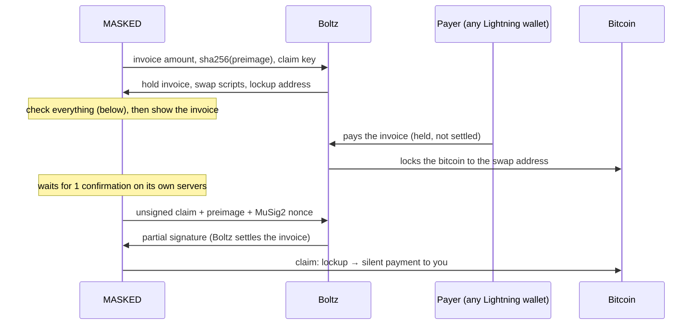

# Lightning to Shielded

**Receive → Lightning** (Mainnet) turns a Lightning payment into a Shielded coin. The payer can use any Lightning wallet. The bitcoin arrives as a silent payment (BIP 352) to your own `sp1…` address.

The swap runs through [Boltz](https://boltz.exchange) as a *reverse swap*. Boltz never holds your money. Either the swap completes, or the Lightning payment is cancelled and the payer keeps their sats.

## The flow

## What the wallet checks before showing an invoice

All of these checks live in `src/lightning/reverse-swap.mjs` (`verifyCreated`):

- **Claim script.** It is rebuilt from our own claim key and preimage hash, and must match Boltz's byte for byte.
- **Refund script.** It is rebuilt from Boltz's key and the time lock, and must match byte for byte. Nothing else may be in the tree.
- **Lockup address.** It must be the taproot output of the MuSig2 key (Boltz first, then us), tweaked with those two scripts.
- **Invoice.** It must be for Mainnet, for exactly the amount asked, and locked to our payment hash. Only we know the preimage.
- **Amounts.** The on-chain amount must match the fees Boltz quoted, and the time lock must be in a sane range.

Before claiming, the wallet also checks two more things. The lockup must pay the swap output exactly once, with at least the agreed amount. The lockup must have one confirmation on the wallet's own blockchain servers, not just according to Boltz. The preimage is only revealed after that.

## The claim is a silent payment

A silent payment output depends on the input keys and outpoints. As the receiver, the wallet holds the scan key. That means it can compute the BIP 352 output for the lockup input itself (`selfSilentOutput`), without the lockup's private key.

The claim has one input (the lockup) and one output (that silent payment). As a result:

- **It looks normal.** The coin is a normal Shielded coin, found by the normal scan, including on a device restored from the recovery phrase.
- **It's unlinkable.** Nothing on-chain links the coin to your `sp1…` address.

## Signing

The claim is signed in one of two ways:

- **Normal case.** It is signed with Boltz using MuSig2 (BIP 327) as a key-path spend. On-chain, it looks like any taproot spend. Boltz's partial signature is checked, and so is the combined signature, before anything is broadcast.
- **If Boltz does not answer or sends a bad signature.** The wallet claims alone through the claim script (script path). This needs only our key and the preimage.

## Keys and storage

Each receive keeps a small record in local storage: the Boltz swap id, the invoice, the scripts' public data, and a random nonce. The claim key and preimage are derived from the spend key and that nonce, so the record alone cannot claim anything.

The signed claim is saved before it is broadcast. If the broadcast fails, it is sent again on the next check.

## Limits

- **Mainnet only.** Boltz's own limits and fees apply. The Receive screen shows them, along with the network fee for the claim.
- **The wallet has to be open to claim.** That includes the side panel. If the swap expires before the claim, the Lightning payment is cancelled and the payer is refunded by Lightning.
- **What Boltz sees.** Boltz sees the swap, but not your `sp1…` address or your other coins.

## Tests

- `test/lightning.test.mjs` checks scripts, key aggregation, the address and control block against `boltz-core`. It also covers MuSig2 signing with boltz-core playing Boltz, the BOLT 11 example from the spec, tampered replies, and a claim output that the BIP 352 scanner finds.
- `test/lightning-flow.test.mjs` runs the whole flow on the real wallet services, for both the key path and the script path. It covers waiting for a confirmation on our own servers, the claim, the coin appearing in Shielded with a working key, and refusing a bad lockup address.
