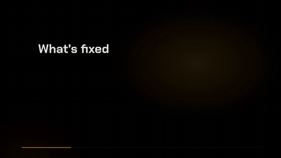
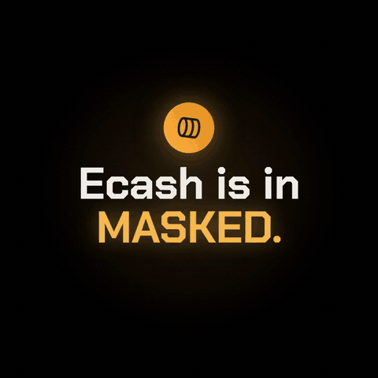
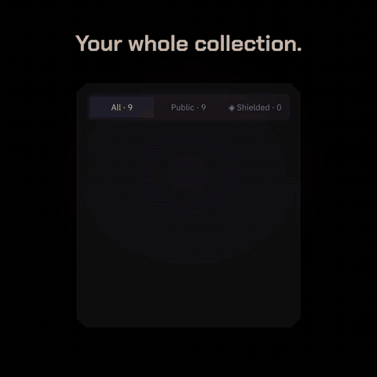

# News and videos

What's new in MASKED, newest first, with the videos. Every version and fix, in detail: [CHANGELOG.md](../CHANGELOG.md).
Updates are posted first by the developer on X: [@ratsonchain](https://x.com/ratsonchain).

## 2.29.28: switching networks fixed · 18 Nov 2026

 <a href="img/masked-2.29.28.mp4"><b>▶ Watch the video (20 s)</b></a>

- **Mainnet ↔ Signet:** switching network (or account) while a scan was running no longer mixes the two up. On Android, Signet kept loading.
- **Repairs itself:** wallets it already happened to start their scan again from the right place. Nothing is lost.
- **RGB opens again** for anyone on 2.29.27 from the Chrome Web Store.
- **Settings:** follow the dev on X and open the source code, one tap away. A one-time note on Home says MASKED is free and open source.
- **The repository:** a [guide](README.md), [Getting started](GETTING-STARTED.md), an [FAQ](FAQ.md), and [AGENTS.md](../AGENTS.md) for AI coding agents.

## 2.29.22–2.29.26: sell in lots, buy several at once · 15–17 Nov 2026

 <a href="img/masked-2.29.26.mp4"><b>▶ Watch the video (39 s)</b></a>

- **Sell in lots:** split a sale into several Instant listings in one approval; they're all on sale at once, even with MASKED closed.
- **Buy several listings at once:** tick the rows you want; MASKED checks each seller's signature and buys the cheapest first.
- **See what's locked, and why:** every RGB output, what it holds and how to free it.
- **Clear history:** a bar while something waits for a block; every trade tagged You bought or You sold.
- **Far fewer requests:** windows share their work, so approvals open fast, ready for many more people.

## 2.29.12–2.29.20: the Android app · 14–15 Nov 2026

- A **Market** tab with MASKED's RGB market and Launchpad, connected to the wallet.
- Copy, paste, RGB and buying work on older phones.
- An **RGB balance** on Home you can add to and move back to Bitcoin.
- Download: [signet.maskedwallet.com/install](https://signet.maskedwallet.com/install) or [Releases](https://github.com/buildOrDie/masked-wallet/releases).

## 2.29.0: the new RGB engine · 13 Nov 2026

- RGB 0.11.2 (transfer protocol 1.0), the version current RGB wallets use.
- Wallets and backups from the previous engine are upgraded in place: same tokens and history.

## Feature videos

| | |
|:-:|:-:|
|  **Ecash** (47 s): top up with bitcoin, pay Lightning, lock a token to an address, pay a website. [Guide](ECASH.md) |  **Ordinals** (18 s): your inscriptions, sent publicly or privately. [Guide](ORDINALS.md) |
