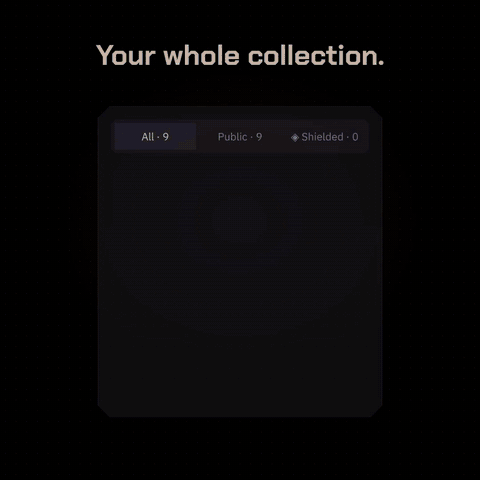
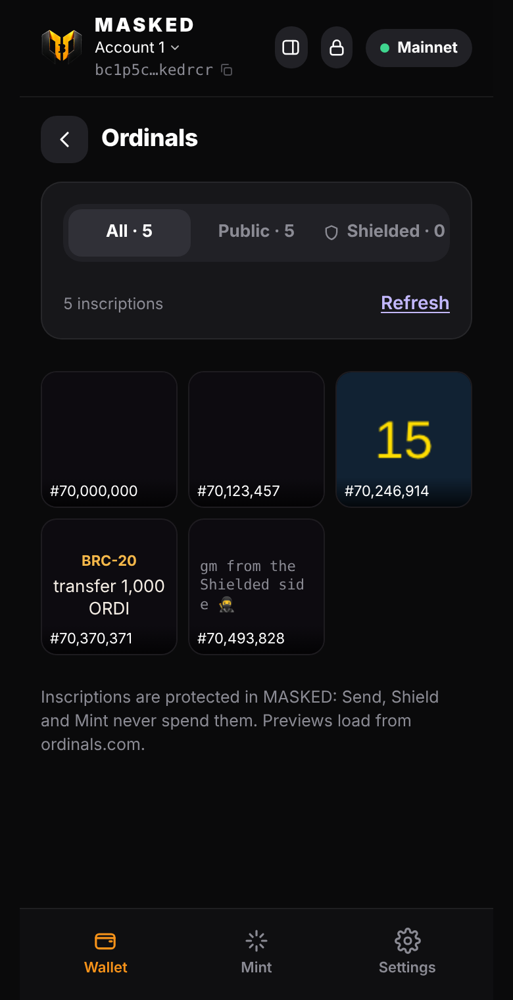
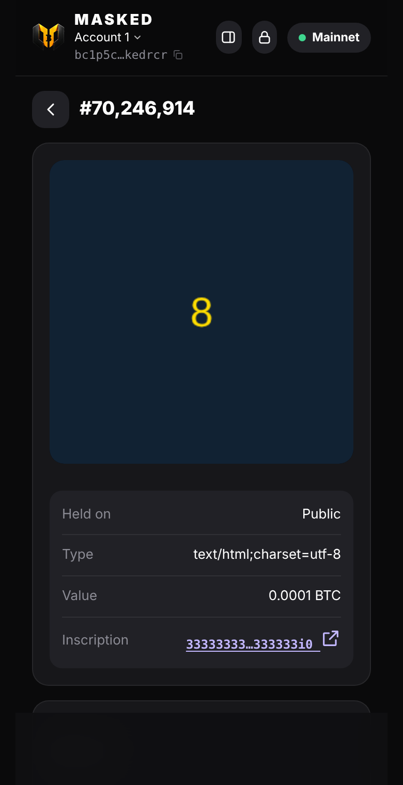
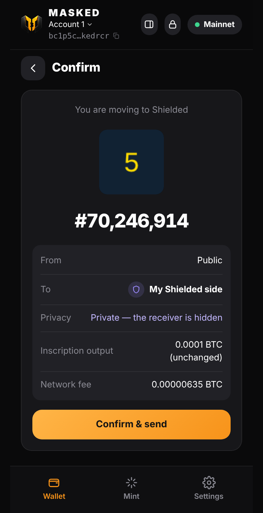

# Ordinals in MASKED

[▶ Watch the video (18 s)](img/masked-ordinals.mp4)

New in 2.21: see the inscriptions you hold on both sides of the wallet, and send them, also **privately to a Shielded address**.

| Gallery | An inscription | Moving it to Shielded |
|:-:|:-:|:-:|
|  |  |  |

## The gallery

- **Home → Ordinals** shows every inscription on your Public and Shielded coins, with All / Public / Shielded tabs.
- Images show as pictures, text as text, BRC-20 inscriptions as "transfer 1,000 ORDI". HTML inscriptions show ord's preview in a sandboxed frame that can't reach the wallet.
- MASKED asks ordinals.com once per coin and remembers the answer (what a coin holds never changes), so refreshing is free.

## Sending safely

- The coin holding the inscription is the **first input**, and the **first output carries exactly its value**. Every sat on it, including the inscription's, at any offset, lands on the recipient's output.
- The network fee comes only from **other plain coins on the same side**. A Shielded inscription is never mixed with Public coins, and other inscription coins are never touched.
- If one coin holds several inscriptions or runes, MASKED says so: they move together.
- The usual look-alike address check runs before you confirm.

## Shield an ordinal

Send the inscription to a Shielded (silent payments, BIP 352) address, or tap **Move to my Shielded side**. The output is a fresh Taproot key that only the receiver can find by scanning, so nobody on the blockchain can tell who holds it now. Inscriptions you move to Shielded appear under the **Shielded** tab once your Shielded balance has seen the coin.

## Code

- [`src/ordinals/Gallery.mjs`](../src/ordinals/Gallery.mjs): which coins hold which inscriptions (ord's `/outputs`), cached per coin.
- [`src/wallet/TxBuilder.mjs`](../src/wallet/TxBuilder.mjs) `sendInscription`: the transaction.
- [`test/ordinals.test.mjs`](../test/ordinals.test.mjs): the inscription stays on output 0 with its value, the fee side, a Shielded receiver finds it, refusals, caching.
